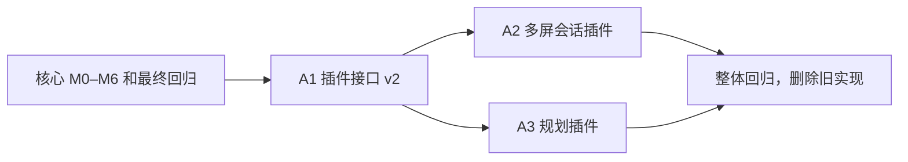

# 网页规划与多屏会话：官方功能插件计划（2026-11-16）

## 目标

把冻结的"网页规划"和"多屏会话"重建为两个**官方功能插件**：

- **多屏会话插件**：默认单会话，保持原样。需要时追加同屏会话，最多三个，所有窗格和原生会话体验一致。
- **规划插件**：一个"规划"入口，默认网页规划，可切到本地规划。规划结果经可编辑预览交接给 Code 会话。

两个插件随安装预装，默认关闭，在"插件"页启用。

## 前置条件

- 核心计划 [2026-11-16-core-replan.md](2026-11-16-core-replan.md) 的 M0 至 M6 全部完成，并通过最终整体回归。
- 本计划是核心之后的下一轮工作，不和核心并行，避免插件接口在核心未稳定时被附加功能需求带偏。

## 定位决策

| 编号 | 决策 |
|---|---|
| A-D1 | 做成"官方功能插件"，不做成核心内置功能。界面和编排在插件里；后端能力（会话流、网页视图、本地规划引擎、交接）留在核心，作为通用能力经插件接口 v2 开放。 |
| A-D2 | 冻结期间旧代码保留，作为行为参考。插件版达到下文验收后，删除旧实现（`renderer.js` 中规划和同屏部分、`SessionGrid.tsx`、`Workbench.tsx`、`workbench/` 下组件、相关样式），不保留两套。 |
| A-D3 | 插件接口 v2 新增的高权限能力（见 A1）首发只授予官方签名的预装插件。是否对第三方开放，等两个插件稳定后再定。 |
| A-D4 | 规划和多屏会话可以同时打开：规划在右侧面板，多屏会话在主区域。 |
| A-D5 | 打开规划或多屏会话时自动收起左侧栏，全部关闭后恢复到打开前的状态。打开前本来就收起的，关闭后不展开。两个插件共用核心提供的引用计数，不各自记状态。 |
| A-D6 | 网页规划不再提供 Cookie 导入。用户直接在网页视图里登录，登录态保存在增强程序自己的隔离分区。 |
| A-D7 | 网页规划首批消息解析适配器覆盖 Kimi、DeepSeek、Gemini、Claude、ChatGPT 五个网站（用户 2026-11-16 确认）。 |

### 为什么做成插件，而不是内置功能

- **符合定位**：这两项是附加功能，用户不用时应该零成本。插件停用即完全卸载，不留入口、监听和订阅。
- **结构性修掉旧问题**：上一轮审查中，订阅不释放（`session.unwatch` 从未调用）、侧栏状态错乱、入口丢失，都是因为没有统一的生命周期。插件作用域在停用时逐项释放资源，这类问题从结构上就不会再出现。
- **检验插件接口**：两个复杂功能能用插件接口实现，说明接口真的够用。它们需要的会话、网页、交接能力，以后第三方插件也能复用。
- **代价**：插件接口要多设计一批高权限挂载点（主区域、右侧面板、网页视图），前期工作量比直接内置多一些。内置的做法短期更快，但会让核心再次膨胀，并且出现两套界面挂载机制。

## 用户已表达的要求（来源：会话 bc480404、925c0615、5afbc274）

多屏会话：

- 默认单会话，保持原生样子；不是每次都强制并排。
- 入口是右侧"添加同屏会话"，从会话列表或弹窗里选，按需追加。
- 所有窗格和原生会话窗口一样，参考 Claude Code 的多会话体验。
- 核心场景：同一项目下两个会话同屏看、同屏处理，不用来回点击跳转。
- 用原生侧栏切换会话时不能和多屏页面重叠。

规划：

- 只保留一个"规划"入口，进去默认网页规划，可切到本地规划；入口不常驻。
- 网页地址不常驻，收进功能栏，保证页面清爽。
- 面板宽度默认沿用官方"侧边聊天"，并且可以像它一样拖动。
- 本地规划不依赖已有会话，可自选模型，交接时才建会话。
- 本地规划可选择是否注入全局上下文、是否加载 Skill、是否开放工具，倾向用预设。
- 网页规划参考 DeepSeek Harness（DSH）"把网页聊天内容导入会话"以及"本地聊天导回网页"的做法。
- 规划时只会用一个聊天来源，网页和本地不会同时用；但可能一边开两个会话窗口并排执行，一边开网页聊天。

---

## A1 插件接口 v2：高权限能力

**结果**：两个官方功能插件需要的能力都可以经插件接口获得。

**依赖**：核心 M3 完成。

### 新增能力

| 能力 | 提供内容 | 使用者 |
|---|---|---|
| `ui:entry` | 在右侧"可打开"列表和 `+` 菜单注册入口；按容器幂等注入（沿用核心 M1 的注入机制） | 两者 |
| `ui:main-area` | 在主聊天区域注册分栏容器，可调整原生主视图宽度 | 多屏会话 |
| `ui:right-panel` | 注册右侧面板动态标签页（打开时出现、带关闭键），宽度沿用官方侧边聊天并可拖动 | 规划 |
| `ui:layout` | 申请"收起左侧栏"，由核心按引用计数处理（A-D5） | 两者 |
| `sessions:approve`、`sessions:abort` | 处理审批、停止运行 | 多屏会话 |
| `sessions:history` | 分页拉取历史回合（不再固定 50 轮） | 多屏会话 |
| `attachments` | 系统文件选择、拖入文件、发送附件 | 两者 |
| `browser:view` | 创建、导航、显示/隐藏、销毁网页视图；读取选区和正文；调用站点适配器 | 规划 |
| `planner:run` | 核心本地规划引擎：线程、模型、预设、流式输出、工具审批 | 规划 |
| `handoff` | 交接预览和提交（新会话或已有会话，普通 / Plan / Tower 模式） | 规划 |
| `models:read` | 可用模型列表 | 规划 |
| `commands` | 插件注册命令，其他插件存在时可调用，例如 `multiSession.open(sessionId)` | 两者 |

### 做法

- 能力在 Go 端按插件身份校验；高权限能力只对官方签名的预装插件生效（A-D3）。签名方式：构建时对插件目录内容算 SHA-256，写入二进制内的允许列表，不引入密钥体系。
- `browser:view` 包装现有 `bootstrap.js` 中的 `WebContentsView` 逻辑；视图归属插件作用域，插件停用时销毁。
- `planner:run` 包装现有 `internal/chat/planner.go`，接口不变，只加插件身份和作用域。
- `ui:main-area` 的形态由 A2 的发现阶段决定（见 A2 第 1 节），A1 先按"可调整原生主视图宽度加右侧分栏"实现。

**验收**：

- Go 测试：第三方插件申请高权限能力被拒；官方插件签名不符时被拒。
- 前端测试：插件停用后网页视图销毁、分栏容器移除、侧栏恢复。
- `docs/PLUGINS.md` 补充 v2 能力说明，并标注哪些暂不对第三方开放。

---

## A2 多屏会话插件

**结果**：用户可以在同一屏同时查看和操作最多三个会话，体验与原生会话一致。

**依赖**：A1。

### 1. 布局方案（先做发现，再定实现）

推荐方案：**主窗格保留原生视图，额外窗格由插件渲染**。

- 主窗格就是官方原生聊天视图，所有原生能力完整保留，侧栏切换会话天然跟随，不会出现重叠或双层顶栏。
- 额外窗格（最多两个）放在原生视图右侧，按原生聊天的视觉渲染。
- 在侧栏选中一个已在额外窗格显示的会话时，两者交换位置，不重复显示。

发现阶段要回答（结论写入 `work/addons/multi-session-layout.md`）：

- 能否只通过调整原生主区域容器的宽度（CSS 和容器尺寸），让原生视图在缩窄后仍正常排版。重点检查输入区、工具卡片、审批卡片和代码块的最小宽度。
- 原生视图在路由切换、打开右侧工具和窗口缩放时，是否会重置宽度。

如果原生视图缩窄后无法稳定排版，退回现有方案：进入同屏模式时隐藏原生视图，所有窗格由插件渲染，主窗格跟随侧栏。退回时必须同时隐藏原生顶栏，避免双层标题。

### 2. 入口与选择

- 入口：右侧"可打开"列表和 `+` 菜单中的"添加同屏会话"，不常驻在标签栏。
- 选择器：原生风格的弹层，带搜索，按项目分组，最近使用的会话在前；当前已显示的会话标记为"已在同屏"。
- 可选增强：在原生侧栏会话的右键菜单加入"在同屏打开"。发现阶段确认原生右键菜单能否稳定注入；做不到就不做。

### 3. 窗格

- **顶栏**：一行，包含会话标题（点击展开菜单：切换会话、设为主窗格、关闭窗格）和运行状态。关闭只作用于当前窗格；关闭最后一个额外窗格即退出同屏模式。不同作用范围不用同一个图标。
- **消息渲染**（对齐原生）：
  - Markdown 保留单换行；
  - 工具卡片显示动作摘要，例如"读取 example.txt 2 行"；
  - 思考块可折叠；
  - 审批卡片可直接处理；
  - 浅色模式下用户消息有清晰边界；
  - 消息操作（复制、引用回复、时间）悬停时显示。
- **滚动**：只有用户停在底部时才跟随新输出；用户上翻时不抢滚动，底部出现"回到底部"按钮。向上滚动到顶时分页加载更早的回合。
- **输入区**：复刻原生 `.composer-card`。
  - 占位符和原生一致；
  - 底栏显示该会话真实生效的模型和权限模式（从会话配置读取，不显示"跟随会话"这类占位文字）；
  - 支持附件按钮、拖入文件、发送和停止。
  - 底栏控件在窄宽度下不折行，放不下时收进"更多"菜单。
- **草稿**：按会话保存，窗格换位置或关闭重开都不丢。
- **订阅**：窗格关闭或切换会话时调用 `session.unwatch`；插件停用时全部释放。

### 4. 宽度与窄窗口

- 单个窗格最小宽度 360px。窗格之间有可拖动分隔条，宽度比例按会话组合记住。
- 宽度不够放下全部窗格时，额外窗格合并成标签页切换（主窗格保持可见），不出现常驻横向滚动条。
- 打开时按 A-D5 收起左侧栏。

### 5. 状态提示

- "额度恢复自动继续"不再做全宽常驻底栏。只有某个窗格的会话真实遇到限流、或正在等待额度恢复时，才在该窗格内显示一条提示。
- 运行中、等待审批只在有实际状态时出现。

### 6. 快捷键

- 发现阶段先列出原生已占用的快捷键，再分配窗格焦点切换（候选 `Cmd+Option+1/2/3`），不覆盖原生快捷键。

### 7. 后续可选

- 把单个窗格弹出为独立窗口，放到副屏。本轮不做，接口预留。

**验收**：

- 隔离宿主中：
  - 默认单会话，界面和原生完全一致；
  - 追加第二、第三窗格时已有窗格不重新挂载；
  - 用原生侧栏切换会话 20 次，不重叠、不重复、主窗格正确跟随；
  - 选中已在额外窗格的会话时正确换位；
  - 上翻阅读时新输出不抢滚动；
  - 关闭窗格后后端订阅数回落（核对 KAP 监听数量）；
  - 1440px 宽且右侧面板打开时不出现横向滚动条；
  - 深浅色截图与原生聊天并排对比。
- 停用插件后：入口消失，原生视图恢复全宽，侧栏恢复到打开前状态。

---

## A3 规划插件

**结果**：一个"规划"入口，在右侧面板里完成网页或本地规划，并把结果交接给 Code 会话。

**依赖**：A1。可与 A2 并行。

### 1. 面板

- 入口：右侧"可打开"列表和 `+` 菜单中的"规划"，不常驻在标签栏。
- 打开后像官方侧边聊天一样，作为右侧面板的动态标签页出现，带关闭键。默认宽度沿用侧边聊天，可拖动，宽度会被记住。
- 只有一层工具条：左侧是来源切换（网页 / 本地），右侧是当前来源的操作和一个"更多"菜单。删除现有的 `SurfaceHeader` 第二层标题栏和重复的设置图标。
- 两个来源各自保留草稿和状态，切换不丢。
- 可弹出为独立窗口（沿用现有能力），关闭后仍可从同一入口重新打开。

### 2. 网页规划（默认来源）

- **打开即加载**：进入时自动打开上次使用的网站，首次默认 `https://www.kimi.com`。不再显示空白页和"也可以直接粘贴网页讨论"。
- **工具条**：后退、刷新、站点快切（用户可编辑的常用站点列表）、"提取"。地址输入放进"更多"菜单，不常驻。
- **登录**：在网页视图里直接登录，登录态保存在隔离分区 `persist:ekd-native-browser`（A-D6）。
- **提取与导入**（参考 DSH 的"网页聊天导入会话"）：
  - 有站点适配器的网站：按消息解析当前对话，用户勾选消息，进入交接预览。
  - 没有适配器的网站：提取选区或页面正文，进入交接预览。
  - 首批站点适配器（A-D7）：`kimi.com`、`chat.deepseek.com`、`gemini.google.com`、`claude.ai`、`chatgpt.com`。每个适配器单独验收；网站改版导致解析失败时，自动退回"选区或正文"并提示。
  - 站点快切的默认列表就是这五个网站，用户可增删。
  - 登录风险：Google 账号可能拒绝在内嵌网页里登录；`claude.ai`、`chatgpt.com` 可能出现人机验证。人机验证只能由用户在可见的网页视图里自己完成，程序不做任何绕过。某个网站确实无法在内嵌视图登录时，界面说明原因，并提供"在系统浏览器打开"，回来后用粘贴内容的方式导入。
- **反向（Code 到网页）**：在交接菜单里提供"把会话摘要或 Diff 放进网页输入框"。只填入，不自动发送。网站内自动发送和读取回复不在本轮范围，界面上不出现看似能发送的假控件。
- 菜单、弹层出现时临时隐藏网页视图，避免遮挡。

### 3. 本地规划

- **不依赖已有会话**：直接开始，交接时才建会话。
- **模型**：从可用模型列表选择，显示在输入区底栏，和原生一致。
- **预设**（显示在输入区底栏，可切换）：

| 预设 | 全局上下文（AGENTS.md 等） | Skill | 工具 |
|---|---|---|---|
| 纯净规划 | 不注入 | 不加载 | 无 |
| 项目审查 | 注入 | 不加载 | 项目内只读：列目录、读文件、搜索 |
| 全功能 | 注入 | 加载 | 只读工具加写文件，写入需审批 |
| 自定义 | 三项分别开关 | | |

- **历史**：规划线程列表放在"更多"菜单里，可重命名、删除。
- **消息**：操作（复制、选择交接、时间）悬停时显示；内部工具调用折叠成一行摘要；代码块右上角有"交接此段"。

### 4. 交接

- 多选消息，或从"交接此段"进入可编辑的预览。
- 目标：新会话（选择项目或工作目录、模型）或已有会话（不改变已有会话的模型）。
- 模式：普通、Plan、Tower。
- 交接成功后，如果多屏会话插件已启用，提供"在同屏打开"（经 `commands` 调用 `multiSession.open`）；未启用则提供"打开会话"。

### 5. 与多屏会话同时使用（A-D4）

- 规划在右侧面板，多屏会话在主区域，两者可以同时打开。
- 宽度不够时，主区域的额外窗格先合并成标签页（见 A2 第 4 节），规划面板宽度保持用户设定。

**验收**：

- 隔离宿主中：
  - 打开规划后直接看到上次的网站，首次是 `kimi.com`；
  - 只有一层工具条，没有重复图标；
  - 网页和本地来源切换后草稿都在；
  - 本地规划三个预设分别验证上下文、Skill、工具是否按表生效（用合成供应商检查实际请求内容）；
  - 写文件工具需要审批；
  - 交接到新会话和已有会话，已有会话的模型不被改变；
  - 五个站点适配器各自完成"打开、登录、提取、交接"全流程（需用户自行登录；无法登录或未验证的站点在验收报告中逐个标明）；
  - 同时打开多屏会话和规划，在 1440px 宽下布局正常；
  - 深浅色截图与官方侧边聊天并排对比。
- 停用插件后：入口消失，网页视图销毁，右侧面板恢复。

---

## 并行与交接

- 文件所有权：A1 负责核心 Go 能力、`plugin-runtime` 和 `bootstrap.js`；A2 只改 `plugins/multi-session/`；A3 只改 `plugins/planner/`。A2、A3 需要新增能力时提给 A1，不直接改核心。
- 执行与审查方式同核心计划：DeepSeek V4.1 Flash 执行，GLM-5.3 Flash 做阶段审查，主会话做最终回归。
- 旧实现删除放在最后一步，必须在 A2、A3 验收全部通过之后。同时移除核心设置里的"附加功能"分组和 `features.planner`、`features.multiSession` 开关，改由"插件"页启停。

## 待用户确认

无。所有决策已确认，可以直接交接执行。
