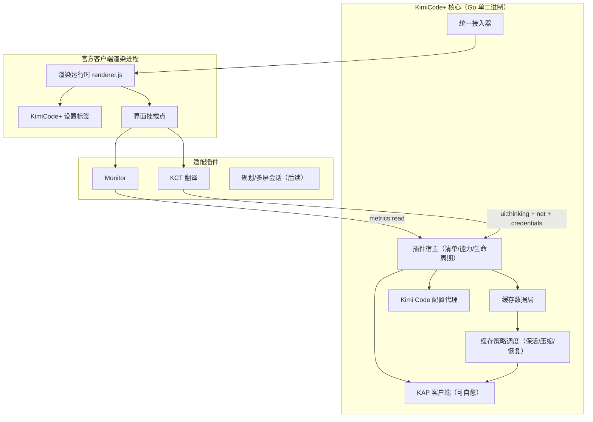
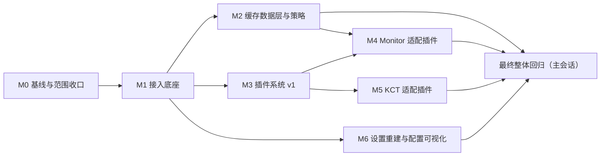

# KimiCode+ 核心重整计划（2026-11-16）

## 目标

把项目从"规划、多屏会话、设置、Monitor 平铺堆叠"重整为三个核心加一个开放插件层：

1. **缓存与额度**：真实缓存命中观测和缓存策略（保活、压缩、额度恢复），是产品的核心价值。
2. **Kimi Code 配置可视化**：在官方设置弹层内调整 Kimi Code 原生配置。
3. **插件系统**：开放的本地插件宿主，插件可复用 KimiCode+ 内部能力，并调用 Kimi Code 能力。
4. **适配插件**：Monitor 和 KCT 都只是"按插件接口适配的插件"，安装时预装，可停用、可卸载，不属于核心。

网页规划和多屏会话降级为附加功能：本轮冻结、默认隐藏，后续改造成可选插件。

所有宿主内界面保持 Kimi Code Desktop 原生的设计感。

> [!IMPORTANT]
> 2026-11-18 修正轮 [2026-11-18-correction-round.md](2026-11-18-correction-round.md) 取代了本计划的以下内容：D3 和 M6 中"供应商与模型、凭据库移到独立管理页"的做法；M3 中把示例插件作为预装插件的做法；M4 的复刻基准（改为上游桌面客户端版，并增加余额）。冲突时以修正轮计划为准。
>
> 2026-11-19 下一轮 [2026-11-19-next-round.md](2026-11-19-next-round.md) 又取代了以下内容：约束里的"不直接写官方存储文件，不回写官方凭据"（改为 N-D1：可改写，须备份、原子写入、可回滚）；D8 中"空闲会话不做保活"（改为 N-D5：空闲会话保活作为可选项，默认关闭）；M3 的插件版本门禁（改为 N-D2：按契约检测放行）。设置分组的位置以该计划的 N-D8、N-D9 和 N6 为准："缓存与额度"页改为 KimiCode+ 标签页里的"缓存"一节，账号进官方"账户"页。冲突时以 2026-11-19 计划为准。

## 背景与依据

- 上一轮审查：会话 `session_323c9f6f-b358-4a4e-afac-340833518cd0`（记录在 `~/.kimi-code/sessions/wd_7_ab05812ffba9/`）。主要结论：设置页硬嵌早期 Mock 页面；Monitor 指标写死 `--`；插件管理只是模拟；`nativeHost` 单例被任意面板卸载清空；KAP 端口和 token 永久缓存导致官方客户端重启后断连；入口注入在运行中丢失；规划和多屏会话有多处 UI 问题。
- 产品原则以 `PRODUCT.md` 为准，本计划改变其中的"产品定位"和"功能优先级"，M0 负责同步文档。
- 上游参考：
  - Monitor：`bfjnbvf/kimi-code-monitor@1d529f0`，MIT，许可已在 `work/kimi-native-enhancement-research-20261110/licenses/`。
  - KCT：用户自有项目 `kimi-cot-translate`，本地仓库 `/Users/wssz277/AgentProjects/kimi-cot-translate`（交接说明见其 `docs/HANDOVER.md`）。它为桌面端思考内容提供内嵌翻译，自带 LaunchAgent 加 SIGUSR1 inspector 的运行时接入器。

## 范围

### 本轮目标

- 宿主接入底座稳定：官方客户端重启可自动重连；面板挂载互不影响；入口幂等注入；日常启动可用。
- 缓存数据层：从本机会话记录读取真实缓存与速度数据，提供统一指标接口。
- "缓存与额度"设置页：缓存总览、会话缓存状态、保活/压缩/额度恢复策略。
- 插件系统 v1：清单、加载、能力接口、界面挂载点、启停卸载、安全模式、版本门禁。
- Monitor 适配插件：只经插件接口取数据，复刻上游可在当前宿主适配的全部功能。
- KCT 适配插件：只保留思考内容翻译逻辑，复用 KimiCode+ 统一接入器和凭据库。
- 设置信息架构重建和 Kimi Code 配置可视化补全。
- 规划与多屏会话改为附加功能开关，默认关闭。

### 非目标

- 不修复规划和多屏会话的 UI 问题（列入后续待办）。
- 不做插件市场、在线安装源或不可信插件沙箱。第三方插件 v1 只支持从本地文件夹或 zip 安装。
- 不移植 KCT 的 CLI、浏览器扩展和 VS Code 入口，只适配桌面端内嵌翻译。
- 不修改官方包体，不直接写官方存储文件，不回写官方凭据。（已修订：2026-11-19 计划 N-D1 放开官方数据和凭据改写，仍不改包体。）
- 本轮只验收 macOS 隔离宿主；Windows 和 Linux 只保证编译通过。

## 已定决策

| 编号 | 决策 |
|---|---|
| D1 | 附加功能（规划、多屏会话）冻结并默认隐藏，代码保留作行为参考。核心完成后重建为官方功能插件，计划见 [2026-11-16-addons-plugins.md](2026-11-16-addons-plugins.md)。 |
| D2 | 插件为"本地受信插件"：运行在宿主渲染进程，可贴合原生 UI。核心 API 在 Go 端按插件能力授权强制校验。界面如实告知"插件可以读取当前界面内容"。 |
| D3 | 设置弹层内只保留真实分组；"用量"并入"缓存与额度"。（已修订）原"供应商与模型""凭据库"独立管理页的做法被修正轮 R-D2、R-D8 取代：模型字段在官方供应商页上增强，凭据管理移到插件详情页。 |
| D4 | 缓存过期时间（TTL）没有公开值，不展示推测的倒计时。只显示"距上次请求 N 分钟"，策略时间由用户设置。 |
| D5 | Monitor 和 KCT 都是适配插件，不得在核心代码里留硬编码挂载或私有通道；核心关闭全部插件后必须完整可用。 |
| D6 | 统一接入器：KimiCode+ 只保留一个运行时接入器，参考 KCT 已长期验证的 macOS 方案（进程身份校验、inspector fuse 检查、SIGUSR1 临时 inspector），替代现在要求 `--user-data-dir` 的接入方式。 |
| D7 | 插件发出的会话消息、配置修改都写入活动记录，并在插件详情里可查。 |
| D8 | 缓存保活只针对一种场景：主会话在等后台子代理返回，主代理自己超过设定时间没有发出模型请求，缓存会丢失（用户实测约 30 分钟）。空闲会话不做保活，由空闲自动压缩替代。详见 M2 第 4 节。（已修订：2026-11-19 计划 N-D5 增加空闲会话保活可选项，默认关闭，与空闲压缩互斥。） |
| D9 | 本机已装的独立版 KCT：检测到时提示迁移，用户确认后停用其后台加载器并迁移非秘密设置；用户拒绝时插件保持停用，绝不双注入。 |
| D10 | Monitor 停用后，核心不在界面上常驻缓存状态显示，只在设置里的"缓存与额度"页展示。常驻显示属于插件的职责。 |
| D11 | 用户已授权本地 git 提交：0.2.0 基线提交和各 mission 合并提交都可以直接进行。不推送远端，不开 PR。 |

以上 D8 至 D11 已由用户在 2026-11-16 确认，本计划没有剩余的阻塞问题。

## 架构总览



## 任务拆分与依赖



M2、M3、M6 在 M1 合并后可并行；M4、M5 可并行。

### 文件所有权（并行时避免冲突）

| 区域 | 所有者 |
|---|---|
| `internal/desktop/kap.go`、`cdp.go`、`inject.go`、`assets/bootstrap.js`、`web/src/host-entry.tsx` | M1 |
| `internal/desktop/automation*.go`、`recovery.go`、新增 `internal/cache/` | M2 |
| `web/src/components/CacheSettings.tsx`（重写为缓存与额度页） | M2 |
| `internal/plugins/`（重写）、新增 `web/src/plugin-runtime/` | M3 |
| 新增插件管理页组件 `web/src/components/PluginSettings.tsx` | M3 |
| `assets/renderer.js` 的挂载点和插件加载部分 | M3（M1 合并后接手） |
| `web/src/components/SettingsSurface.tsx`、`NativeSettings.tsx`、`native-settings-surface.css` | M6 |
| 新增 `plugins/monitor/` | M4 |
| 新增 `plugins/kct/` | M5 |

M6 负责设置分组外壳，M2 和 M3 只交付各自分组的页面组件，由 M6 接入。

---

## M0 基线与范围收口

**结果**：当前 0.2.0 工作区被固定为可回溯基线；附加功能默认隐藏；文档反映新定位。

**依赖**：无（D11 已授权本地提交）。

**做法**：

1. 确认 `git status` 中 116 个改动都属于 0.2.0 返修。排除日志、截图、临时产物后，提交为 `chore: preserve 0.2.0 baseline before core replan`。只做本地提交，不推送。
2. 新增功能开关 `features.planner`、`features.multiSession`，默认 `false`，存 SQLite `native_state`。关闭时：
   - `renderer.js` 不注入规划和"添加同屏会话"入口，也不注入右栏 `.ptb-tabs` 胶囊。
   - 已打开的面板正常卸载，恢复原生内容。
3. 删除侧栏底部克隆的"KimiCode+ 设置"按钮。设置入口只保留官方设置弹层里的 KimiCode+ 标签。
4. 更新 `PRODUCT.md`、`DESIGN.md`、`README.md` 的定位和优先级；`docs/IMPLEMENTATION_PLAN.md` 顶部注明已被本计划取代。
5. 根目录 `启动增强演示.command` 改为启动当前 Go 二进制（M1 完成接入后再改成日常启动方式）。

**验收**：

- `go test ./cmd/... ./internal/...`、`go vet ./cmd/... ./internal/...`、`cd web && npm run typecheck && npm test` 全部通过。
- 隔离宿主中：右侧"可打开"面板、`+` 菜单、标签栏都看不到规划和同屏入口；侧栏底部没有重复的设置按钮；打开开关后入口恢复。

---

## M1 宿主接入底座

**结果**：增强层在官方客户端的整个生命周期里稳定可用，可以接入从程序坞正常启动的 Kimi Code。

**依赖**：M0。

**做法**：

1. **KAP 自愈**（`internal/desktop/kap.go`）：请求遇到连接失败或 401 时，清除缓存的端口和 token，重新解析一次再重试；WebSocket 断线后指数退避重连，并恢复已有的 watch 订阅。
2. **宿主上下文按实例注入**（`web/src/host-entry.tsx`）：删除模块级 `nativeHost` 和 `installDemoHost(null)` 清空逻辑，改为 React Context，每个挂载实例持有自己的宿主对象。`NativeSettings.tsx` 等组件改从 Context 取。
3. **事件单通道**：渲染进程只保留一个 `events.poll` 循环，在运行时内广播给各挂载面；删除 `PlannerPane` 的 250ms 额外轮询。
4. **入口按容器幂等注入**（`renderer.js` 的 `syncNativeEntries`）：对每个可见的宿主菜单容器（空面板 `.sit`、`+` 下拉菜单 `.pl`）分别检查并挂载，判断依据是"该容器内是否已有入口"，不再用全局单引用加 `isConnected`。
5. **统一接入器**（D6）：
   - 发现阶段：先阅读 KCT 的 `runtime.mjs` 和 `runtime-hook.mjs`，产出一页对照说明（放 `work/`），列出进程身份校验、fuse 检查、SIGUSR1 inspector、渲染结构校验和失败降级各步骤，以及与现有 `cdp.go` 的差异。
   - 实现阶段：Go 端实现等价流程，去掉 `--user-data-dir` 硬性要求；官方客户端重启或刷新后自动重新接入。
   - 常驻方式沿用 KCT 的 LaunchAgent `WatchPaths` 事件驱动思路，不轮询。是否安装 LaunchAgent 由用户在设置中显式开启，默认关闭。
6. **侧栏开合**（按用户原始要求）：打开增强面板时自动收起左侧栏，全部关闭后恢复到打开前的状态；打开前本来就收起的，关闭后不展开。核心提供引用计数接口 `layout.acquireSidebarCollapse()`，返回释放函数；删除 `renderer.js` 里规划和同屏共用的单个 `state.collapsed` 布尔值。附加功能冻结期间这项只需接口和测试，供后续插件使用。

**验收**：

- 新增 Go 测试：KAP 端口变化后自动恢复；WebSocket 断线后订阅恢复。
- 新增前端测试：卸载一个挂载面后，其他挂载面的宿主调用仍成功。
- 隔离宿主中：重启官方客户端，增强层无需手动操作即恢复；打开和关闭设置标签、切换侧栏会话 20 次，入口不丢失、不重复。
- 从程序坞正常启动的 Kimi Code 可以被接入（需用户授权后在日常实例上验证；未授权时在隔离副本上验证并说明）。验收记录注明宿主与 Electron 版本。官方升级后在对应版本复查挂载、设置保存、插件启停和退出清理。

---

## M2 缓存数据层与缓存策略

**结果**：用户能看到每个会话和模型真实的缓存命中情况，并配置缓存策略。

**依赖**：M1。

### 1. 数据来源（已确认的事实）

Kimi Code 会话记录位于 `~/.kimi-code/sessions/<工作目录桶>/<session_id>/`：

- `state.json`：`cwd`、`title`、`createdAt`、`updatedAt` 等。
- `agents/<agent>/wire.jsonl`：`main` 是主代理，其他目录是子代理。每行一个 JSON 事件，相关事件有两类：
  - `context.append_loop_event` 中 `event.type == "step.end"`，字段 `usage{inputOther, output, inputCacheRead, inputCacheCreation}`，以及 `llmFirstTokenLatencyMs`、`llmStreamDurationMs`、`llmServerDecodeMs`、`messageId`、`time`。
  - `usage.record`，字段 `model`、`usage`、`usageScope`（如 `"turn"`）、`time`。

`KIMI_CODE_HOME` 环境变量存在时以它为根目录。

### 2. 读取与存储（新增 `internal/cache/`）

- 只读，按文件 inode 加偏移量增量读取，记录读取位置，文件被截断或替换时从头重读。
- 不写任何官方文件。
- 存入 SQLite 表 `cache_steps(session_id, agent, step_uuid, model, time, input_other, input_cache_read, input_cache_creation, output, first_token_ms, stream_ms, PRIMARY KEY(session_id, agent, step_uuid))`。模型从同一轮的 `usage.record` 关联；关联不上时记 `UNKNOWN`。
- 文件监听用 fsnotify 或定时扫描（间隔不短于 5 秒）。发现阶段先确认项目是否已有 fsnotify 依赖，没有时用定时扫描，不新增依赖。

### 3. 指标定义和接口

- 缓存命中率 = `input_cache_read / (input_other + input_cache_read + input_cache_creation)`。
- 生成速度 = `output / 解码时长`。发现阶段需先用真实样本确认 `llmStreamDurationMs` 是否包含首字延迟，再决定解码时长取 `stream_ms - first_token_ms` 还是 `llmServerDecodeMs`，结论写进测试注释。
- **如实显示未知**：某模型在统计窗口内从未上报过非零的 `input_cache_read` 或 `input_cache_creation`，显示"供应商未上报缓存数据"，不显示 0%。
- 新增 `NativeService.Action`：
  - `cache.summary`：近 1 小时和今日的总命中率、读取/创建/未命中 token、平均速度，按模型分组。
  - `cache.sessions`：活跃会话列表，含标题、模型、最近一次请求时间、最近 5 步命中率、上下文 token 估计。
  - `cache.history`：参数 `range = 24h | 7d | 30d`，返回按小时或按天聚合的序列。
  - `cache.retention`：按"距上一次请求的空闲时长"分桶（如 0–2、2–5、5–10、10–30、30 分钟以上），统计每个桶里第一次请求的命中率，按模型分组。这是用真实数据观察缓存大约能保留多久的唯一依据，用来帮用户设定保活时间，不换算成倒计时（D4）。
- 原 `monitor.summary` 删除；额度相关字段并入 `cache.summary` 的 `quota` 子对象，未知时为 `UNKNOWN`。

### 4. 缓存策略（D8）

**要解决的问题**：主会话把任务交给后台子代理后，自己在等结果。子代理跑得久时，主代理超过约 30 分钟没有发出模型请求，主会话的缓存就丢了；子代理返回后，主会话要按未命中价格重新计算整段上下文。

**现状与差距**：`automation_scheduler.go` 的 `runKeepAlive` 在会话运行中（`Busy || MainTurnActive`）且 `lastActivity` 超过设定分钟数（默认 25）时发送"继续"。场景是对的，但有三个问题要修：

1. `lastActivity` 是整个会话的活动时间。子代理一直在产出事件时它会不断刷新，保活就永远不触发。必须改成"主代理最近一次模型请求的时间"：从 M2 的 `cache_steps` 取 `agent = 'main'` 的最后一步时间，或从 KAP 事件里只取主代理的步骤。
2. 发送的文字"继续"可能让主代理改变行为。改为固定的最小保活文案，明确告诉主代理"这是缓存保活，不需要任何操作，继续等待后台任务"。文案在发现阶段定稿，并写进测试。
3. 发出后没有核对缓存是否真的续上了。改为闭环：保活发出后，读取主代理下一步的 `input_cache_read`。命中则记"保活成功"，未命中或没有产生新的模型请求则记"保活无效"并附原因。

**发现阶段（必须先做，结论写入 `work/replan-20261116/keepalive-findings.md`）**：在隔离宿主上用合成供应商验证两种等待状态下，保活消息是否真的触发主代理的一次模型请求：

- 状态 A：主代理用后台子代理后结束本回合，等待完成通知。
- 状态 B：主代理停在阻塞式等待中（前台子代理或 `WaitFor` 类工具）。

如果某个状态下消息只是排队、不会产生模型请求，就在界面上说明该状态无法保活，不能假装成功。

**最终策略**：

- **后台等待保活**：条件是会话运行中、有后台子代理未返回、主代理最近一次模型请求距今达到设定分钟数（默认 25，范围 5 至 60），且没有待处理的审批或交互。默认关闭。
- **空闲自动压缩**：会话空闲达到设定分钟数（默认 25）时压缩，替代空闲会话的保活。默认关闭。保留"ACK 只记为已接收，官方完成事件才记为完成"的现有规则。
- **额度恢复**：现有逻辑保留，默认关闭。
- 三项分别授权。同一会话不会同时触发保活和压缩：会话运行中只可能保活，空闲时只可能压缩。
- 界面说明代价：每次保活消耗一次请求的额度，并在主会话里留下一条消息。

### 5. 设置页"缓存与额度"（重写 `CacheSettings.tsx`）

分组顺序：

1. 概览：今日命中率、读取/创建/未命中 token、平均速度、额度状态。
2. 会话：活跃会话列表，每行显示标题、模型、命中率、主代理"距上次请求 N 分钟"，以及是否有后台子代理在运行。
3. 策略：后台等待保活、空闲自动压缩、额度恢复，各自开关和时间。总开关关闭时子项折叠。保活时间旁边展示 `cache.retention` 的观测结果作为参考。
4. 用量：原用量页中仍有价值的实际用量记录。
5. 最近执行记录：保活（成功/无效及原因）、压缩、恢复的回执，明确区分"官方已接收"和"官方已完成"。

本页不新增侧栏或输入区的常驻显示（D10）。

表单规则：开关即时保存；数字失焦校验后保存；后台 `automation` 事件不得覆盖正在编辑的草稿。

**验收**：

- Go 测试：用构造的 `wire.jsonl` 片段验证增量读取（追加、截断、替换）、命中率、"未上报"判定、速度计算。
- 用本机真实会话目录只读运行一次，抽查 3 个会话的数值和手算一致。
- 隔离宿主中：设置页深浅色截图读回；编辑数字时后台事件不清空草稿；三项策略分别开关并读回持久化结果。
- 保活：Go 测试覆盖"子代理持续产出事件但主代理无请求时仍会触发""有待审批时不触发""会话空闲时不触发而走压缩"；隔离宿主中用合成供应商把阈值调到 5 分钟，跑一个长时间后台子代理，确认保活发出、主代理下一步 `input_cache_read > 0`，执行记录显示后续请求读取了缓存。另以真实模型的有无保活对照衡量后续命中率、额外保活开销和总用量。

---

## M3 插件系统 v1

**结果**：KimiCode+ 有一个真正可用的本地插件宿主。Monitor 和 KCT 能完全通过它实现。

**依赖**：M1。

### 1. 插件包结构

```
<插件目录>/
  plugin.json
  renderer.js      # ES module，导出 activate(ctx)
  settings.js      # 可选，导出 renderSettings(ctx, element)
  assets/          # 可选
  LICENSE
```

`plugin.json`：

```json
{
  "id": "kimicode-plus.monitor",
  "name": "Monitor",
  "version": "1.0.0",
  "apiVersion": 1,
  "description": "缓存命中、Token 速度与 Kimi 形象",
  "hostVersions": ["1.3.5"],
  "entry": { "renderer": "renderer.js", "settings": "settings.js" },
  "capabilities": ["metrics:read", "sessions:read", "ui:sidebar", "ui:settings", "storage"],
  "upstream": { "repo": "bfjnbvf/kimi-code-monitor", "commit": "1d529f0", "license": "MIT" }
}
```

### 2. 能力清单 v1

| 能力 | 提供内容 |
|---|---|
| `metrics:read` | `cache.summary`、`cache.sessions`、`cache.history` 和缓存事件订阅 |
| `sessions:read` | 会话列表、会话内容、会话事件订阅 |
| `sessions:send` | 向指定会话发送消息、新建会话 |
| `config:read` / `config:write` | 经核心代理读写 Kimi Code `/config` |
| `ui:sidebar` | 侧栏底部挂载点 |
| `ui:settings` | 插件在"插件"页里的设置子页 |
| `ui:thinking` | 思考内容块装饰点（KCT 使用） |
| `ui:message` | 消息块装饰点（预留，v1 可只定义接口） |
| `net:<host>` | 经 Go 代理访问指定主机，`<host>` 必须在清单中逐个列出 |
| `credentials:<name>` | 在网络代理请求中注入凭据库里的指定凭据；凭据明文不进入渲染进程 |
| `storage` | 插件私有键值存储（SQLite） |

### 3. 运行时接口（`web/src/plugin-runtime/`）

```ts
interface PluginContext {
  plugin: { id: string; version: string; dataVersion: number };
  core: { request<T>(action: string, payload?: unknown): Promise<T> };
  events: { on(name: string, listener: (payload: unknown) => void): Disposable };
  ui: {
    mount(slot: "sidebar" | "settings", render: (element: HTMLElement) => Disposable | void): Disposable;
    decorate(target: "thinking" | "message", decorator: (block: HTMLElement, info: BlockInfo) => Disposable | void): Disposable;
    theme(): { scheme: "light" | "dark"; tokens: Record<string, string> };
  };
  net: { fetch(url: string, init?: ProxyRequestInit & { credential?: string }): Promise<ProxyResponse> };
  storage: { get<T>(key: string): Promise<T | undefined>; set(key: string, value: unknown): Promise<void> };
  log(level: "info" | "warn" | "error", message: string): void;
}
```

- `core.request` 携带插件身份令牌；Go 端按清单能力白名单校验，未授权返回 `403 PLUGIN_CAPABILITY_DENIED`。
- `ui.decorate` 由运行时统一用一个 MutationObserver 观察宿主 DOM，插件不得自建全局 Observer。宿主结构校验失败时不回调插件，并把插件标记为"宿主版本不兼容"。
- 每个 `Disposable` 都登记到插件作用域；停用插件时运行时逐个释放，并检查残留节点。
- 挂载点容器不铺任何背景色，继承宿主 CSS 变量。运行时提供一份原生样式基础类（复用宿主的 `setting-card` 等结构类名和 `--color-*` 变量），插件优先使用。

### 4. 核心插件宿主（重写 `internal/plugins/`）

- 删除全部模拟插件、`FAULT` 动作和 `simulateActivation`。
- 安装位置：`<dataDir>/plugins/<id>/`。预装插件随二进制嵌入，首次运行或版本升级时释放；用户卸载后不再自动释放，可在"插件"页"恢复预装插件"。
- 安装第三方插件：选择本地文件夹或 zip，校验清单，展示能力申请，用户确认后安装。
- 状态持久化：已安装、已启用、授予的能力、插件私有存储、活动记录（D7）。
- 版本门禁：宿主版本不在 `hostVersions` 内时，默认不启用并提示"未在此版本验证"，用户可手动强制启用。（已修订：2026-11-19 计划 N-D2 改为按接口和界面契约检测放行。）
- 安全模式：一键停用全部插件，核心功能不受影响。
- 插件异常：`activate` 抛错或运行时连续报错超过阈值，自动停用并在插件页显示原因。

### 5. 插件管理页（`PluginSettings.tsx`）

列表行：名称、版本、来源（预装/本地）、状态（已启用/已停用/不兼容/出错）。详情页：能力清单、活动记录、插件自己的设置子页、停用、卸载。页面顶部有安全模式开关和"安装本地插件"。

**验收**：

- Go 测试：能力白名单拦截；清单校验失败；版本门禁；卸载后数据清理；安全模式。
- 前端测试：停用插件后挂载节点和 Observer 全部释放；插件抛错不影响其他插件。
- 用一个最小示例插件（`plugins/example-hello/`，只挂侧栏一行文字）走通安装、启用、停用、卸载全流程。示例插件也作为第三方开发者的参考。
- 新增 `docs/PLUGINS.md`：插件开发说明，包含清单字段、能力、运行时接口、原生样式要求和示例。

---

## M4 Monitor 适配插件

**结果**：Monitor 是一个预装的适配插件，复刻上游在当前宿主可适配的全部功能，数据全部来自 M2 指标接口。

**依赖**：M2、M3。

**做法**：

1. 删除核心里的 `MonitorSurface.tsx`、`renderer.js` 中的 Monitor 挂载代码和相关样式，迁到 `plugins/monitor/`。
2. 功能对照上游 `kimi-code-monitor@1d529f0`（参考 `work/ui-review-20261116/monitor-*.js|css`）：
   - 2x2 指标（输入、输出、缓存命中、速度）和折线趋势。
   - 24h / 7d / 30d 历史柱图（`cache.history`）。
   - 活跃子代理列表。
   - 迷你模式一键折叠。
   - Kimi 形象（宠物模块）。
   - 上游的缓存提示规则只在有真实数据支撑时显示；上游"缺失补零"和经验 TTL 不复刻（D4）。
3. 视觉：挂载容器完全透明，融入官方毛玻璃侧栏；深浅色都要和官方侧栏协调。
4. 插件设置子页：迷你模式默认值、是否显示 Kimi 形象、统计窗口。
5. 随插件交付上游 MIT 许可。

**验收**：

- 关闭 Monitor 插件后，核心"缓存与额度"页数据不受影响，侧栏恢复为纯官方样式。
- 隔离宿主深浅色截图，与官方侧栏并排对比，无不透明色块。
- 与 M2 的"缓存与额度"页同一时刻数值一致。

---

## M5 KCT 适配插件

**结果**：KCT 的桌面端内嵌思考翻译作为预装适配插件运行，复用统一接入器和凭据库。

**依赖**：M3（M1 的统一接入器）。

**做法**：

1. 从 `/Users/wssz277/AgentProjects/kimi-cot-translate/kct.js` 提取渲染端翻译逻辑：语言选择、自动翻译、原文/译文切换、只翻译需要的部分、保留代码块和段落。独立版仓库不改动。
2. 改造点：
   - 思考块定位改用 `ctx.ui.decorate("thinking", ...)`，删除自带 Observer 和窗口事件。
   - 翻译请求改用 `ctx.net.fetch`，接口地址写进清单的 `net:<host>`；密钥存凭据库，用 `credentials:<name>` 注入，删除 `localStorage` 里的 `customKey`。
   - 翻译缓存用 `ctx.storage`。
   - 会话文件和模型上下文保留原文，这一点与独立版一致。
3. 与独立版共存（D9）：
   - 启用插件前检测独立版是否在运行（LaunchAgent `com.user.kimi-cot-translate.runtime`、`~/Library/Application Support/kimi-cot-translate/`）。
   - 检测到时显示迁移提示，说明会停用独立版的后台加载器。用户确认后再停用，并可迁移其非秘密设置（目标语言等）。
   - 用户拒绝迁移时，插件保持停用，绝不双注入。
4. 插件设置子页：目标语言、翻译服务、凭据选择、清除翻译缓存。
5. 随插件交付 KCT 的许可和 NOTICE。

**验收**：

- 在隔离宿主上用合成翻译服务（本地 mock HTTP）验证：展开思考后自动翻译，原文/译文切换，代码块不被翻译。
- 停用插件后思考块恢复原样，无残留节点。
- 模拟"独立版已安装"环境：未确认迁移时插件不能启用；确认后独立版停用，只存在一份注入。
- 凭据明文不出现在渲染进程（检查运行时网络请求和存储）。

---

## M6 设置重建与 Kimi Code 配置可视化

**结果**：KimiCode+ 设置标签只剩真实分组，视觉和交互与官方设置一致；Kimi Code 配置可视化覆盖常用配置。

**依赖**：M1。M2、M3 的页面组件交付后接入。

**做法**：

1. 首页分组（官方设置卡片行样式，行尾用 `›`）：
   1. 缓存与额度（M2 页面）
   2. Kimi Code 配置
   3. 插件（M3 页面）
   4. 附加功能：规划、多屏会话开关，标注"实验"
   5. 状态与诊断：连接状态、宿主版本兼容性、统一接入器状态、日志、开源许可
   6. 跳转行：模型、供应商与凭据（打开独立管理页）
2. 删除 `.ekds-embed` 硬嵌页面和对应样式，以及 `WorkspacePage`、`PluginsPage`、`SettingsPage` 在设置弹层里的引用；独立管理页里仍需要的页面保留，但必须修复暗色徽章（`theme.css` 中限定在 `.secondary-shell` 下的问题）。
3. 删除三处重复的"空闲压缩阈值"，只保留 M2 页面里的一处。
4. Kimi Code 配置页（基于现有 `NativeSettings.tsx`）：
   - 保留：工具开关、子代理模型池、子代理时限、单轮步数上限、权限与危险命令。
   - 发现阶段：调用 KAP `GET /config`，列出实际返回的字段，对照本机 `config.toml` 的分区（`thinking`、`swarm`、`secondary_model`、`subagent`、`experimental` 等），产出"可读、可写、生效时机"对照表（放 `work/`）。
   - 只为 `/config` 实际支持读写的字段增加界面；不支持的字段不做界面、不直接写 `config.toml`。
   - 涉及密钥的字段（`providers.*` 下的凭据）不显示、不编辑。
   - 每项标注生效时机（即时、下一轮、下次派生），沿用现有 `TIMING` 定义。
5. 表单规则与 M2 一致：开关即时保存，数字失焦保存，子项在总开关关闭时折叠。

**验收**：

- 隔离宿主深浅色截图，与官方设置页（`work/ekd-final-integration/official-settings-dark.png` 等）并排对比：字号、间距、圆角、行高、行尾图标一致。
- 每个可写配置项修改后，经 `GET /config` 读回一致；重启官方客户端后仍生效。
- 设置弹层内找不到任何 Mock、模拟或"不会连接官方客户端"字样。

---

## 原生 UI 硬性要求（所有任务适用）

- 只用宿主 CSS 变量（`--font-ui`、`--color-bg`、`--color-text`、`--color-line`、`--blue` 等）和原生组件结构类名，不另起配色和字号体系。
- 嵌入容器不铺不透明背景；侧栏内的内容必须透出官方毛玻璃材质。
- 入口不常驻，不加品牌栏，不重复官方已有的入口。
- 不出现内部错误码作为主文案；错误提示说明当前状态和下一步，诊断信息折叠在详情里。
- 每个新界面都要在隔离宿主里深色、浅色各截一张图，和官方对应界面并排读回检查。

## 后续待办（本轮不做）

- 规划和多屏会话重建为官方功能插件，详见 [2026-11-16-addons-plugins.md](2026-11-16-addons-plugins.md)。上一轮审查中这两个功能的 UI 问题已并入该计划的验收。
- Windows 统一接入器（参考 KCT 的 `runtime-windows.mjs`）。
- 插件在线安装源和签名校验。

## 交接方式

- 建议用 Tower 模式执行：M0 由主会话完成；M1 单独一个 mission；M1 合并后 M2、M3、M6 并行；之后 M4、M5 并行。
- 执行子代理使用 DeepSeek V4.1 Flash；每个 mission 完成后由 GLM-5.3 Flash 做独立审查；最终整体回归和审查由主会话完成，核对合并后的完整 diff、测试和本计划。
- 每个 mission 的完成标准：本节验收全部通过；`go test ./cmd/... ./internal/...`、`go vet ./cmd/... ./internal/...`、`cd web && npm run typecheck && npm test`、`make build` 通过；涉及界面的改动附隔离宿主截图。
- 隔离宿主验证脚本在 `work/ekd-final-integration/verify-*.mjs`，需要按新结构更新或新增；旧的 `verify-planner-flow.mjs`、`verify-multi-session.mjs` 在附加功能关闭期间只需保证开关打开时仍能运行。
- 发现阶段的产出（接入器对照说明、`/config` 字段对照表、速度字段确认）放 `work/replan-20261116/`，不混入交付。
