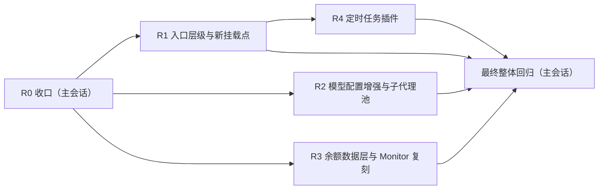

# KimiCode+ 修正轮计划（2026-11-18）

## 目标

修正用户验收 A3 规划插件合并版本时提出的问题，并新增定时任务插件。本轮完成后：

1. 插件入口进入官方"会话信息"这一层，并严格跟随插件启用状态。
2. Kimi Code 配置可视化补齐官方供应商页缺少的模型字段，不再另做独立的模型与凭据页。
3. 子代理池从官方已配置的模型里选择，不再手填。
4. Monitor 按上游桌面客户端版复刻界面、形象和操作，并补上余额显示。
5. 新增"定时任务"官方功能插件。
6. 示例插件不再预装。

本计划是 [2026-11-16-core-replan.md](2026-11-16-core-replan.md) 和 [2026-11-16-addons-plugins.md](2026-11-16-addons-plugins.md) 之后的下一轮。两份旧计划中与本计划冲突的条目，以本计划为准，冲突处已在旧计划里标注。

## 背景与依据

- 用户反馈来自会话 `session_7580e701-ca14-4e4f-a61b-34f7f047edef`（记录在 `~/.kimi-code/sessions/wd_7_ab05812ffba9/`），2026-11-18 讨论定稿。
- 官方客户端版本 1.3.7。前端资源在 `/Applications/Kimi Code.app/Contents/Resources/desktop-dist/assets/`，主要文件是 `main-BKblNnDM.js`（组件和 KAP 客户端）和 `SegmentedControl-CnFLnNib.js`（中文文案）。文件名带哈希，官方更新后会变。
- Monitor 上游：`bfjnbvf/kimi-code-monitor@1d529f0`，MIT。本地源码在 `work/kimi-native-enhancement-research-20261110/work/sources/bfjnbvf__kimi-code-monitor/`。扩展版和桌面版共用的面板源码在 `src/panel-app/`，样式在 `content.css`，形象动画在 `rive/`，截图在 `docs/screenshots/`。
- 余额实现来源：用户自有项目 Kimi Work+，活跃源码在 `/Users/wssz277/new project/任务 6/work/.tmp/go-wails-phase2-20261110/integration/`，余额代码在 `internal/quota/`。

## 用户决定（执行会话不要再问）

| 编号 | 决定 |
|---|---|
| R-D1 | 插件入口注册为一种"可打开标签类型"，同时出现在两处：官方"会话信息"的"可打开"分组，以及右侧面板的空白面板列表和 `+` 菜单。与官方"侧边聊天"的行为一致。插件停用时两处都不出现。 |
| R-D2 | 官方供应商功能可以导入模型，但模型能力、最大输出、推理强度、自适应思考没有图形界面，只能改配置文件。KimiCode+ 在官方供应商页上补齐这些字段的图形化编辑，作为"Kimi Code 配置可视化"的一部分。不再保留独立的"模型与供应商"页。 |
| R-D3 | 示例插件 `example-hello` 不再预装，只作为开发模板留在仓库和 `docs/PLUGINS.md` 里。 |
| R-D4 | Monitor 以上游的桌面客户端版为复刻基准。浏览器版独有的功能不做。余额显示要做，实现移植自 Kimi Work+。 |
| R-D5 | 定时任务做成预装、默认关闭的官方功能插件。界面在插件里，调度引擎在核心，作为通用能力经插件接口开放。 |
| R-D6 | 验收和演示环境不得替用户启用插件。需要启用插件的验收只能在隔离宿主里做，并在结果中写明启用了哪些插件。 |
| R-D7 | 多屏会话和网页规划的其余问题不在本轮。 |

以下几项是主会话在用户授权范围内定的默认做法，执行时照做。用户后续要改再单独调整。

| 编号 | 默认做法 |
|---|---|
| R-D8 | 独立的"凭据库"页删除。凭据库后端保留，供插件的 `credentials:<name>` 能力使用。凭据的增改删移到插件详情页，每个插件只显示它申请的凭据。 |
| R-D9 | 定时任务的主入口放在官方左侧栏"新建会话"下方的一行，点开后在主区域显示任务页。"会话信息 → 可打开"里另有一个"定时任务"入口，只显示绑定当前会话的任务。 |
| R-D10 | 定时任务错过的运行（例如当时官方客户端没开），在客户端恢复后合并补跑一次，不逐次补跑。每个任务可改成"跳过错过的运行"。 |

## 已确认的官方事实（1.3.7）

### 会话信息与右侧面板

- 标题栏 `ChatHeader` 有"显示会话信息 / 隐藏会话信息"按钮，触发 `toggleSessionInfo`。
- 会话信息渲染为 `aside.session-info`。宿主宽度大于等于 960 时带 `is-sidebar`，否则带 `is-floating`。
- 会话信息只在以下条件同时满足时显示：功能启用、当前会话符合条件、有活动会话，并且右侧面板没有打开。所以它和右侧面板互斥。
- 会话信息内部依次是：文件夹行（主目录、改动、PR），以及 `SessionInfoTabs` 组件（class 为 `.sit`）。
- `SessionInfoTabs` 分两组：
  - "已打开标签页"：`sit-opened`。最多显示 5 个，超出时显示"查看更多（{count}）"。
  - "可打开"：`sit-available`。过滤掉 diff 和 inspector 类型，点击会调用 `open(type)`。
- 右侧面板展开后，空白面板里也有一份可打开列表（`.pt-body .sit`），标签栏的 `+` 下拉是 `.pt-body .pl`。

### 模型与供应商接口（KAP）

官方渲染进程的 KAP 客户端有以下方法，见 `main-BKblNnDM.js` 中的 `listModels`、`addProvider`、`updateProvider`：

| 方法 | 接口 |
|---|---|
| 模型列表 | `GET /models` |
| 供应商列表 | `GET /providers` |
| 供应商详情（含 `api_key`） | `GET /providers/{id}` |
| 新增供应商 | `POST /providers` |
| 更新供应商 | `PUT /providers/{id}` |
| 删除供应商 | `DELETE /providers/{id}` |
| 目录 | `GET /catalog/providers`、`GET /catalog/providers/{id}` |

`POST` 和 `PUT` 中每个模型可以携带这些字段：

| 字段 | 含义 | 官方界面 |
|---|---|---|
| `model` | 模型 ID | 有 |
| `max_context_size` | 上下文长度 | 有 |
| `display_name` | 显示名 | 有 |
| `capabilities` | 能力数组，取值 `image_in`、`video_in`、`tool_use`、`thinking`、`always_thinking` | 没有，只在切换模型面板里只读显示 |
| `max_output_size` | 最大输出长度 | 没有 |
| `support_efforts` | 可选的推理强度列表 | 没有 |
| `adaptive_thinking` | 自适应思考 | 没有 |

官方"添加供应商"表单的模型表只有三列：模型 ID、上下文、显示名。

官方判断思考模式的逻辑：
- `capabilities` 含 `always_thinking` 时为"始终开启"。
- 含 `thinking`，或 `adaptive_thinking` 为真时，为"可开关"。
- 其余为"不支持"。

### 左侧栏

左侧栏顶部有"新建会话"、搜索和"进行中 / 已完成 / 项目"三个标签，没有功能导航列表。

### 本项目现状

- 入口注入：`internal/desktop/assets/renderer.js` 约 436 行起的 `entryContainers()` 只查找 `.pt-body .sit, .pt-body .pl`，完全没有处理 `aside.session-info`。停用插件时 `renderer.js:724` 会删除入口。
- 规划"自己出现"：原因是上一轮验收脚本通过接口同时启用了规划和 Monitor，没有告诉用户。不是默认值的问题。
- 子代理池：`web/src/components/NativeSettings.tsx:292` 只从 `/config` 返回的 `models` 键里取选项。列表为空时，`NativeSettings.tsx:223` 退化成手填的"模型别名"输入框。
- 独立模型页：`web/src/pages/ModelsPage.tsx`（1486 行）维护一套自己的模型目录，后端在 `internal/provider/`、`internal/registry/`。凭据页是 `web/src/pages/CredentialsPage.tsx`，后端在 `internal/credentials/`。入口在 `web/src/components/ManagementWindow.tsx` 和 `web/src/App.tsx`。
- 插件能力：`internal/plugins/capability.go` 已有 `ui:entry`、`ui:main-area`、`ui:right-panel`、`ui:sidebar`、`sessions:send` 等。
- Monitor 插件：`plugins/monitor/renderer.js` 是重新实现的，不是上游代码移植。与上游对比，缺编辑模式、模块菜单、模块折线、余额，形象也不是上游的 Rive 动画。

## 任务拆分与依赖

R1、R2、R3 在 R0 之后并行。R4 依赖 R1 的挂载点，R1 合并后开始。

### 文件所有权

| 区域 | 所有者 |
|---|---|
| `internal/desktop/assets/renderer.js` 中入口注入和挂载点部分、`internal/plugins/capability.go`、`web/src/plugin-runtime/` | R1 |
| `plugins/planner/` 的入口注册部分 | R1 |
| `web/src/pages/ModelsPage.tsx`、`CredentialsPage.tsx`、`ManagementWindow.tsx`、`App.tsx` 路由、`web/src/components/NativeSettings.tsx`、`web/src/components/PluginSettings.tsx` 的凭据区 | R2 |
| 官方设置弹层中供应商页的注入代码（新增文件，由 `renderer.js` 引用一行） | R2 |
| 新增 `internal/quota/`、`plugins/monitor/` | R3 |
| 新增 `internal/scheduler/`、`plugins/scheduler/` | R4 |

R2、R3 需要在 `renderer.js` 或 `capability.go` 加内容时，只加独立文件和一行引用，合并冲突由后合并的一方解决。

---

## R0 收口（主会话）

**结果**：示例插件不再预装；验收脚本不再替用户启用插件；文档同步本计划。

**做法**：

1. 从预装清单中移除 `plugins/example-hello`（`plugins/embed.go`、`plugins/registry.go`）。目录保留，`docs/PLUGINS.md` 说明它是开发模板，并写明怎样通过"安装本地插件"加载它。已经装过示例插件的用户，升级后不自动卸载，但"恢复预装插件"不再恢复它。
2. 检查 `work/ekd-final-integration/verify-*.mjs` 和启动脚本。所有启用插件的调用只能在隔离宿主数据目录里执行，并在输出里打印"本次验收启用的插件"。
3. 同步 `PRODUCT.md`，并在旧计划中标注被取代的条目（已在本计划定稿时完成）。

**验收**：

- 全新数据目录启动后，插件页里没有示例插件，规划和 Monitor 都是停用状态。
- `go test ./cmd/... ./internal/...` 通过。

---

## R1 入口层级与新挂载点

**结果**：插件入口出现在官方会话信息的"可打开"分组，以及右侧面板的空白列表和 `+` 菜单。插件停用时两处都没有入口。新增左侧栏挂载点，供定时任务使用。

**依赖**：R0。

**做法**：

1. 调整 `ui:entry` 的语义：插件注册一个"可打开标签类型"，内容是 `{ id, title, icon, open() }`。运行时把它注入三个位置：
   - 会话信息 `aside.session-info` 中的"可打开"分组（`sit-available`），排在官方条目之后。
   - 右侧面板空白页的可打开列表（`.pt-body .sit`）。
   - 右侧面板标签栏的 `+` 下拉（`.pt-body .pl`）。
2. 注入的条目复制官方条目的 DOM 结构和 class，图标尺寸、间距、悬停和焦点样式与官方一致。注入按容器幂等，官方重渲染后自动补回，不重复插入。
3. 从会话信息点击插件入口：调用官方打开右侧面板的路径，再在右侧面板中打开插件标签。会话信息随之按官方逻辑隐藏，不要手动隐藏它。
4. 插件标签打开后收起右侧面板，会话信息的"已打开标签页"里应当能看到这个插件标签，点击可重新打开。如果官方结构不允许注入"已打开"分组，写清原因，只做"可打开"分组。
5. 会话信息的 sidebar 模式和 floating 模式（窗口宽度小于 960）都要支持。
6. 入口严格跟随插件状态：
   - 插件未启用或未授予 `ui:entry` 时，三处都不注入。
   - 运行中停用插件，入口在下一帧内消失。
   - 运行中启用插件，入口在下一帧内出现，不需要刷新。
7. 新增能力 `ui:sidebar-nav`：在官方左侧栏"新建会话"下方插入一行，结构和样式复制官方侧栏行。首发只授予官方预装插件，规则同 A-D3。点击时由插件决定行为，通常是打开 `ui:main-area` 页面。
8. 规划插件改用新的入口注册方式。全仓搜索确认，规划插件停用时，没有任何硬编码代码会显示规划入口或面板。
9. 更新 `docs/PLUGINS.md` 中 `ui:entry` 和 `ui:sidebar-nav` 的说明。

**验收**：

- 前端测试：
  - 停用插件后三处入口全部移除。
  - 启用和停用切换 20 次后，没有重复节点，也没有残留的 Observer。
  - 官方重渲染会话信息后，入口自动补回。
- 隔离宿主深浅色截图，每张都与官方同一位置并排对比：
  - 规划插件停用：会话信息"可打开"只有官方条目。
  - 规划插件启用：会话信息"可打开"、右侧面板空白列表、`+` 菜单都出现"规划"。
  - 从会话信息点击"规划"后，右侧面板打开规划，会话信息隐藏。
  - 窗口宽度小于 960 时，floating 模式下入口正常。
- 运行中停用规划插件，三处入口立即消失。截图或录屏为证。

---

## R2 模型配置增强与子代理池

**结果**：在官方供应商页上可以图形化编辑模型能力、最大输出、推理强度和自适应思考。子代理池从官方模型列表里选择。独立的"模型与供应商"页和"凭据库"页删除。

**依赖**：R0。

**做法**：

### 1. 发现阶段（产出放 `work/correction-20261118/`）

- 经 KAP 实际调用 `GET /models`、`GET /providers`、`GET /providers/{id}`，记录返回字段。记录时 `api_key` 一律脱敏。
- 确认以下几点，结果写成对照表：
  - `PUT /providers/{id}` 不带 `api_key` 时，是否保留原密钥。
  - `models` 数组是否整体替换。
  - Kimi 订阅这类托管供应商能否写入。
  - 修改后对新会话、当前会话、模型切换分别何时生效。
- 确认 `GET /models` 中每个模型的标识，与 `config.toml` 里 `secondary_model` 引用的模型键是什么对应关系。
- 从 `GET /catalog/providers/{id}` 和官方预设里收集 `support_efforts` 实际出现过的取值。
- 列出 `internal/provider/`、`internal/registry/`、`internal/credentials/` 在删除独立页面后还有哪些调用方，例如规划插件的本地规划、KCT 的凭据。

### 2. 官方供应商页增强

- 在官方设置弹层的供应商页里，每个已保存供应商的模型行末尾加一个图标按钮"能力与限制"，样式和官方行内图标按钮一致。
- 点击后打开编辑浮层，样式沿用官方设置弹层的对话框。字段如下：

  | 界面 | 写入字段 |
  |---|---|
  | 图片输入、视频输入、工具调用三个开关 | `capabilities` 中的 `image_in`、`video_in`、`tool_use` |
  | 思考模式三段选择：不支持 / 可开关 / 始终开启 | 分别对应：不含 `thinking` 和 `always_thinking`；含 `thinking`；含 `always_thinking` |
  | 自适应思考开关（仅"可开关"时可用） | `adaptive_thinking` |
  | 上下文长度（数字，带 K/M 换算提示） | `max_context_size` |
  | 最大输出长度（数字，带 K/M 换算提示，可留空） | `max_output_size` |
  | 推理强度（多选标签，选项来自发现阶段，并允许补充自定义值） | `support_efforts` |

- 保存流程：先 `GET /providers/{id}` 读当前完整配置，只改目标模型的这几个字段，再整体 `PUT`。不发送 `api_key`，前提是发现阶段确认不发送会保留原密钥。保存后重新 `GET` 核对，一致才提示"已保存"，并说明生效时机。
- 托管供应商如果不能写入，编辑浮层只读，并说明原因。
- 官方"添加供应商"表单不注入。表单底部加一行提示："保存后可在模型行设置能力与限制"。不要去改官方表单的内部状态。
- 增强代码运行在核心，属于"Kimi Code 配置可视化"，不是插件。核心关闭全部插件后仍然可用。

### 3. 删除独立页面

- 删除 `ManagementWindow.tsx` 和 `App.tsx` 中的 `/models`、`/credentials` 页面，以及设置弹层里打开独立管理页的跳转行。
- 删除 `ModelsPage.tsx`、`CredentialsPage.tsx` 和它们的样式、测试。
- 按发现阶段的调用方清单处理后端：
  - 仍有调用方的保留。
  - 没有调用方的整体删除，不留转发导出。
- 凭据管理移到插件详情页（`PluginSettings.tsx`）：显示该插件申请的凭据，支持添加、替换、删除。凭据明文只在 Go 端，渲染进程只看到"已设置 / 未设置"。
- 完成后同步 `PRODUCT.md` 的 Assumptions 一节。其中"设置首页为五项分组和一个独立管理窗口跳转行"要改成删除跳转行之后的实际结构。

### 4. 子代理池

- 选项改为来自核心代理的 `GET /models`。每个选项显示：显示名、供应商、能力摘要（例如"图片 · 工具 · 思考"）。
- 写回 `secondary_model` 时，使用发现阶段确认的模型键格式。
- 删除手填输入框。没有模型时显示空状态："还没有可选的模型，请先在 Kimi Code 设置 → 供应商中添加。"并提供按钮打开官方供应商页。
- 已保存的池内模型如果不在当前列表里，保留显示，并标注"当前供应商中找不到这个模型"，不静默丢弃。
- 搜索项目中其他让用户选择模型的地方（例如规划插件的本地规划模型），统一改用同一个数据源和同一个选择组件。

**验收**：

- Go 测试：供应商更新时只改目标模型字段，其他模型和密钥保持不变；读回校验失败时报错。
- 前端测试：思考模式三段与 `capabilities`、`adaptive_thinking` 的双向映射；子代理池没有手填输入框。
- 隔离宿主：
  - 给一个自定义供应商的模型打开"图片输入"、设置最大输出、选择推理强度。保存后，官方切换模型面板中显示对应能力。重启官方客户端后仍然生效。
  - 子代理池下拉中出现官方已配置的全部模型。选择后，`GET /config` 读回的 `secondary_model` 正确。
  - 深浅色截图与官方供应商页并排对比。
- 全仓搜索不到 `/models`、`/credentials` 独立页面的路由和入口。

---

## R3 余额数据层与 Monitor 复刻

**结果**：Monitor 的界面、形象、操作与上游桌面版一致，数据全部来自 KimiCode+ 核心，并能显示 Kimi Code 额度和外部供应商余额。

**依赖**：R0。

### 1. 余额数据层（核心，新增 `internal/quota/`）

- 移植 Kimi Work+ 的 `internal/quota/`：
  - `source.go` 中的端点：DeepSeek `https://api.deepseek.com/user/balance`，Moonshot 国内 `https://api.moonshot.cn/v1/users/me/balance`，Moonshot 国际 `https://api.moonshot.ai/v1/users/me/balance`。
  - `accounts.go` 中的解析器 `ParseDeepSeekBalance`、`ParseMoonshotBalance`。
  - `codeusage.go`：Kimi Code 订阅额度，端点 `https://api.kimi.com/coding/v1/usages`。
  - `magpie.go`：本机 Magpie 额度 `GET http://127.0.0.1:3425/v1/magpie/quotas`。
- 对照上游 `src/providers.js`，补上 Kimi Work+ 没有、上游有的来源，例如 BigModel `open.bigmodel.cn/api/monitor/usage/quota/limit`。最终支持范围取两者的并集。
- 凭据来源：
  - 外部供应商：在 Go 端经 KAP `GET /providers/{id}` 读取官方已配置的密钥，按供应商类型和 Base URL 匹配余额端点。
  - Kimi Code 额度：沿用 Kimi Work+ 的"本机 Kimi Code 已登录"来源。
  - 密钥只用于 Go 端的请求头，不进入渲染进程、日志、快照或活动记录。
- 保留 Kimi Work+ 的不变量：读数带来源、凭据标识和时间；读取失败时绝不显示为 0；失败时只能回退到同一身份的上一次读数。
- 轮询：只在 Monitor 的余额模块可见时每 60 秒读取一次，模块收起即停止。这与上游行为一致。
- 经插件接口开放为 `metrics:read` 下的 `quota.balances` 动作。
- 在 `NOTICE` 中注明代码来自用户自有项目 Kimi Work+。

### 2. Monitor 复刻（替换 `plugins/monitor/`）

- 不再重新实现。直接移植上游 `src/panel-app/`、`content.css` 和 `rive/`（`rive.js`、`rive.wasm`、`kimi_avatar_web-*.riv`），保留上游的 DOM 结构、样式、交互和中文文案。
- 只替换数据适配层：

  | 上游数据来源 | 替换为 |
  |---|---|
  | KAP WebSocket 事件和 REST 轮询 | 插件接口 `sessions:read` 事件订阅 |
  | `usage-daily.js` 历史预填和 localStorage 累积 | `metrics:read` 的 `cache.history`、`cache.sessions` |
  | 当前会话的输入、输出、缓存命中、速度 | `cache.summary` |
  | 加油包和供应商余额 | `quota.balances` |
  | localStorage 中的面板布局和偏好 | 插件 `storage` |

- 必须具备的功能（上游桌面版）：
  1. 模块化面板：长按进入编辑模式；把模块拖到"隐藏 / 仅完整模式 / 迷你也保留"三个区；区内拖拽排序；半宽和全宽混排。
  2. 每个模块的 ≡ 菜单，放该模块自己的设置。
  3. 5 小时和每周额度条，带重置倒计时和节奏参考线。
  4. 每日用量 24h / 7d / 30d，主代理和子代理堆叠。
  5. 统计模块拉到全宽时，显示本会话逐轮折线，悬停显示具体数值。
  6. Rive 蓝球形象：
     - 空闲时呼吸并显示时间。
     - 运行时切换加载动画并计时，工具调用不打断计时。
     - 回答完成时撒彩带。
     - 限流、子代理工作、重连各有专属动作。
     - 点击触发随机动作。
     - 旁边的状态文字区分"思考中"和"执行中"，并按状态着色。
     - 数据位轮播 6 项：24h 用量、输入、输出、缓存命中、速度、余额。
  7. 余额：加油包余额，以及跟随客户端供应商的外部余额。点击跳转对应的充值页或控制台。
  8. 迷你模式。
  9. 侧栏整理（隐藏 logo），可选，默认关闭。
- 不复刻：
  - 缓存到期提醒：与核心 D4（不展示推测的过期倒计时）和缓存保活重复。
  - 浏览器版独有的功能：桌宠、回复书签、分享卡片、自动归档、额度桌面通知、popup 套件。
  - 上游的安装器、补丁、扫描脚本：数据由核心提供。
- 上游的缓存提示规则（`cache-hint-rules.js`），只在有真实数据支撑时显示。
- 挂载在左侧栏底部（`ui:sidebar`），容器透明，透出官方毛玻璃材质。
- 插件随附上游 MIT 许可。Rive 形象资源是 Kimi 官方形象，上游一并分发，本项目沿用上游的分发方式，并在 `NOTICE` 中注明来源。

**验收**：

- Go 测试：
  - 各余额解析器使用 Kimi Work+ 的测试数据。
  - 读取失败不产生 0。
  - 密钥不出现在任何返回给渲染进程的数据里。
- 前端测试：
  - 编辑模式三区拖拽后，布局能持久化。
  - 停用插件后没有残留节点、定时器和 Rive 实例。
- 隔离宿主：
  - 与上游截图 `docs/screenshots/head.png`、`hero.png`、`edit-mode.png`、`quota.png` 逐张并排对比，布局、字号、颜色、动效一致，深浅色各一张。
  - 功能清单的 9 项逐项演示，留截图或录屏。
  - 跑一轮真实会话，形象依次出现思考、执行、完成三种状态。
  - 与核心"缓存与额度"页同一时刻数值一致。
  - 检查渲染进程的网络请求和存储，确认没有供应商密钥。

---

## R4 定时任务插件

**结果**：用户可以创建按时间自动运行的 Kimi Code 任务。任务在新会话或指定会话中执行，结果进入带未读标记的运行记录。

**依赖**：R1（`ui:entry`、`ui:sidebar-nav`）。

参考了三个产品的官方文档：
- Codex Automations：提示词加调度，可选在独立 worktree 运行，结果进入收件箱。
- ZCode 自动化：定时任务与闲时任务，可在会话中创建并把结果投递回原会话，有只读模板，可设置结束日期。
- WorkBuddy 定时任务：单次和周期两种调度，有启用、暂停、停用状态，建议先低频试运行，保留执行日志。

Kimi Code 内置的 CronCreate 只在会话存活且空闲时触发，不跨会话。本插件由核心持久调度，这是差异点。

### 1. 核心调度引擎（新增 `internal/scheduler/`）

- SQLite 存两张表：任务和运行记录。
- 新增能力 `schedule:manage`，首发只授予官方预装插件。
- 调度规则用结构化 JSON 保存：
  - 单次：指定日期和时间。
  - 预设：每小时、每天、每个工作日、每周（可选星期几）、每月（可选日期）。
  - 自定义：间隔（分钟或小时），或一天中的多个时点，加星期几。
  - 每个规则都可设生效开始日期和结束日期。
  - 下次运行时间按本机时区计算。
- 执行条件：KimiCode+ 核心在运行，并且官方客户端的 KAP 可以连通。
- 错过的运行按 R-D10 处理：默认合并补跑一次，可改为跳过。
- 同一任务不重叠运行。全局同时运行的任务数默认最多 2 个。
- 插件停用时，核心不触发该插件的任务，但保留数据。卸载插件时询问是否删除任务和运行记录。

### 2. 执行方式

- 新开会话模式：经 KAP 在任务指定的项目目录里新建会话，设置模型、推理强度和权限模式，然后发送提示词。
- 绑定会话模式：把提示词发到指定的已有会话。
  - 会话正忙时，等它空闲，最多等 10 分钟。超时把这次运行记为"跳过"，并说明原因。
  - 任务卡片显示该会话"距上次请求 N 分钟"，并提示是否还在用户设置的缓存保活时间内。按 D4，不推测缓存过期时间。
- Worktree 选项：发现阶段确认 KAP 或核心是否已有创建 worktree 的能力（参考 `internal/future/workspace.go`）。有就做，没有就在界面上不显示该选项，并记入后续待办。
- 权限模式：只提供 KAP 实际支持的模式，发现阶段列出。无人值守时如果出现审批请求，不自动批准，把运行状态记为"等待批准"，在运行记录里提示用户去处理。
- 模型和推理强度：用 R2 的模型选择组件，数据来自 `GET /models`，推理强度选项来自该模型的 `support_efforts`。
- 每次发送消息和新建会话都写入活动记录（D7）。

### 3. 插件界面

- 左侧栏入口"定时任务"（`ui:sidebar-nav`），点开在主区域（`ui:main-area`）显示两个标签：
  - 任务：任务卡片列表。每张卡片显示名称、调度摘要（例如"每个工作日 09:00"）、下次运行时间、上次结果和启用开关。卡片操作有编辑、立即运行一次、暂停、删除。
  - 运行记录：按时间倒序。每条显示状态（排队、运行中、完成、失败、等待批准、跳过）和未读标记，点击打开对应会话。支持全部标为已读，并可设置"完成后自动标为已读"。
- 新建和编辑表单，样式沿用官方设置弹层的对话框。字段：
  - 名称、提示词。
  - 项目目录。
  - 执行方式：新开会话，或绑定会话。
  - 模型、推理强度、权限模式。
  - 调度。
  - 错过的运行：补跑一次，或跳过。
- 4 个只读分析模板：
  - 每日代码变更摘要。
  - TODO 与 FIXME 汇总。
  - 依赖更新与安全公告检查。
  - 测试失败巡检。
- 新建任务的默认调度为"每天一次"。表单里有"立即试运行"按钮，提示用户先低频试运行。
- 会话信息"可打开"里的"定时任务"入口（`ui:entry`）：在右侧面板列出绑定当前会话的任务，并提供"为本会话创建定时任务"，表单会预填绑定会话和项目目录。
- 空状态、加载中、失败、成功都要有明确文案。官方客户端未连接时，说明任务会在恢复连接后按"错过的运行"规则处理。

**验收**：

- Go 测试：
  - 各种调度规则的下次运行时间：单次、预设、自定义、开始和结束日期、跨月、跨年。
  - 错过运行的合并补跑与跳过。
  - 同一任务不重叠。
  - 核心重启后任务和下次运行时间保持不变。
  - 插件停用后不触发。
- 隔离宿主：
  - 用测试模式（允许每分钟一次）创建一个新开会话任务。到点后，新会话用所选模型收到提示词，运行记录出现未读条目。
  - 绑定会话任务把提示词投递到原会话；会话正忙时，等待和跳过的逻辑正确。
  - 停用插件后左侧栏和会话信息入口消失，任务不再触发；重新启用后恢复。
  - 深浅色截图，与官方左侧栏和设置对话框并排对比。
- 真实模型请求只用用户已授权的测试模型。不确定时先问用户，不擅自产生收费调用。

---

## 原生 UI 与通用要求

- 沿用 [2026-11-16-core-replan.md](2026-11-16-core-replan.md) 的"原生 UI 硬性要求"。
- 新增界面优先复制官方同类组件的结构和 class，不自己重新设计。官方没有对应组件时，使用宿主 CSS 变量。
- 不常驻没有被用户启用的入口。插件入口只经 `ui:entry` 和 `ui:sidebar-nav` 注入。

## 后续待办（本轮不做）

- 多屏会话插件（A2）和网页规划的其余问题。
- 定时任务的闲时任务、外部推送通知、"没有发现时自动归档"（需要可靠的结果判断，先不做）。
- 定时任务的 worktree 模式（如果发现阶段确认现有能力不足）。

## 交接方式

- 建议用 Tower 模式执行：R0 由主会话完成；R1、R2、R3 三个 mission 并行；R1 合并后开始 R4。
- 执行子代理使用 DeepSeek V4.1 Flash。每个 mission 完成后由 GLM-5.3 Flash 做独立审查。最终整体回归和审查由主会话完成，核对合并后的完整 diff、测试、截图和本计划。
- 每个 mission 的完成标准：
  - 本节验收全部通过。
  - `go test ./cmd/... ./internal/...`、`go vet ./cmd/... ./internal/...`、`cd web && npm run typecheck && npm test`、`make build` 通过。
  - 涉及界面的改动附隔离宿主深浅色截图，并与官方或上游对应界面并排。
- 发现阶段的产出放 `work/correction-20261118/`，不混入交付。
- 本地 git 提交按 D11 已授权，不推送远端，不开 PR。
