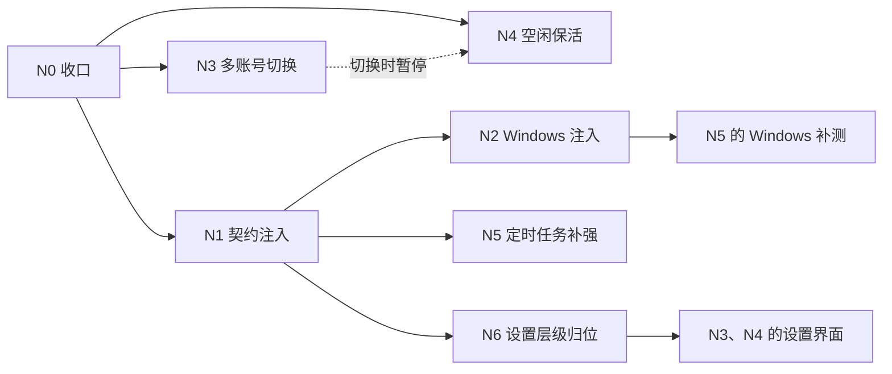

# KimiCode+ 下一轮计划（2026-11-19）

## 目标

本轮完成后：

1. 注入不再按官方版本号放行。只要官方没改相关接口和界面结构，官方客户端升级后注入和修改继续生效；某个接入点变了，只停用对应功能，其余照常工作。
2. Windows 上实现和 Mac 一样的官方界面内原生注入。
3. 多个 Kimi Code 订阅账号可以一键切换，不退出客户端，会话不受影响。这是核心功能，产品价值归入"缓存与额度"，界面入口放在官方"账户"页。
4. 新增"空闲会话保活"可选项：在设定的次数或时长内持续保活，不压缩。
5. 定时任务补齐自动接入和无人值守需要的能力。
6. 收口上一轮遗留：未提交的改动、配置往返安全、文档与验证记录同步。
7. 设置层级与官方对齐：能增强官方已有页面的内容放进官方对应页面，KimiCode+ 标签页只保留官方没有的内容，并且平铺显示，不再先列表后子页。

本计划接在 [2026-11-18-correction-round.md](2026-11-18-correction-round.md) 之后。和旧计划冲突的条目以本计划为准，冲突处已在旧计划里标注。

## 用户决定（执行会话不要再问）

| 编号 | 决定 |
|---|---|
| N-D1 | 允许改写官方的用户数据、配置和凭据（例如 `~/.kimi-code/credentials/kimi-code.json`、`config.toml`），只要对项目有帮助。改写前必须备份，写入要原子化，失败要能回滚。仍然不改官方程序包体（`/Applications/Kimi Code.app` 或 Windows 安装目录里的文件）。 |
| N-D2 | 注入以"接口和界面结构是否还在"为准，不以版本号为准。官方升级后，只要契约检测通过就继续注入。 |
| N-D3 | Windows 必须做官方界面内的原生注入，不接受只提供独立工作台。KCT 已证明可行。 |
| N-D4 | 多账号指多个 Kimi Code 订阅账号。要求点击即切换、不退出客户端、不影响会话。属于核心功能。账号间自动路由本轮不做。 |
| N-D5 | 空闲会话保活：设置里有全局开关（默认关）和默认保活次数（默认 2 次），单个会话可以覆盖。保活间隔按供应商类型自动推导，不让用户填。 |
| N-D6 | 定时任务不做开机自启。定时任务依赖 Kimi Code 运行，只需要保证 Kimi Code 启动时增强核心跟着接入。防止休眠沿用官方客户端自带的"防止休眠"设置，不另做。 |
| N-D7 | 本地 git 提交继续按 D11 授权，不推送远端，不开 PR。 |
| N-D8 | 设置按官方层级归位（见 N6 的对照表）：账号进官方"账户"页，子代理池和权限规则进官方"智能体与会话"页，会话并排进官方"实验室"页，模型能力留在官方"模型供应商"页。KimiCode+ 标签页只保留缓存、增强插件、状态与诊断三节，平铺在同一页。 |
| N-D9 | 我们的插件在界面上统一叫"增强插件"，留在 KimiCode+ 标签页里，不挂进官方"插件"页，避免和官方插件市场重名，也避免官方插件页改版时被连带破坏。 |

## 已确认的事实

### 官方设置与会话信息的结构（1.3.7，来自官方语言包）

- 设置弹层的标签页：通用、浏览器、智能体与会话、账户、模型供应商、远程控制、关于、已归档的会话、快捷键、插件、实验室（键名 `settings.tabs.*`）。
- "账户"页已显示套餐用量：5 小时限额、每周限额、重置倒计时、加油包余额（`planUsage.*`）。
- "智能体与会话"页有"Agent 默认值"（默认模型、默认权限、默认计划模式）和"子智能体"一节（子智能体模型、思考强度）。官方认识"子智能体模型池"：选"跟随默认模型"时提示会删除当前模型池及其描述（`secondaryModelClearPoolMessage`），但没有编辑模型池的界面。
- "插件"页是官方插件市场：插件市场、我的插件、官方、精选、自定义。
- "实验室"页放实验开关，例如"多标签页的会话列表"（开启后左侧栏变成进行中、已完成、项目三个标签）和"进展更新"。
- 通用页有系统通知开关，覆盖回合完成、待回答、待审批三种情况。
- 官方设置里有"返回{page}"这类子页文案，说明官方也用一层子页，例如插件详情。
- 会话信息依次是：主目录、改动、已打开标签页、可打开、查看更多。右侧面板打开时会话信息隐藏，窗口宽度小于 960 时变成浮层。
- 现状：我们在设置弹层里只占一个"KimiCode+"标签，里面是 5 行列表，点进去才是子页（`web/src/components/SettingsSurface.tsx:12`）。其中"插件"和官方"插件"页重名，"附加功能"和官方"实验室"重叠，子代理池和官方"子智能体"重叠。"插件"一行的说明"Monitor 与故障隔离"已过时。

### 注入的版本绑定

- `internal/desktop/cdp.go:203` 的 `SupportedHosts` 是版本白名单，只放行 1.3.4、1.3.5、1.3.7，Electron 版本也要匹配。`HostIdentity.Contract()`（`cdp.go:216`）遇到不在名单里的版本直接拒绝。所以官方每次升级，注入都会整体失效。
- `docs/NATIVE_INTEGRATION.md:40` 写的也是"仅接受明确列出的宿主版本"。
- 官方前端资源文件名带哈希（例如 `main-BKblNnDM.js`），每个版本都会变，所以不能按文件名定位。

### Windows 接入

- `internal/desktop/cdp_platform_other.go` 里的 `activateInspector` 是空实现，所以 Windows 上的注入是关着的。
- Mac 的接入方式是向官方主进程发 `SIGUSR1`，让它打开 Node inspector（`docs/NATIVE_INTEGRATION.md:34`）。Windows 没有这个信号。
- KCT 在 Windows 上的做法（源码 `work/kimi-native-enhancement-research-20261110/work/sources/wssz527__kimi-cot-translate/runtime-windows.mjs`）：
  - `process._debugProcess` 在 Windows 上要求宿主注册处理函数，官方没有注册，所以不可用（第 256 行的注释）。
  - 改为通过固定的启动器带 `--remote-debugging-port=<端口>` 启动 Kimi Code，再连接渲染页面（第 162 到 170 行、第 550 行）。
  - 同时核对进程的 SID、可执行文件路径、启动时间（第 191 行），并检查 Electron fuse（第 219 行）。
- EKD 现在把带 `--remote-debugging` 参数的实例一律视为调试实例，不自动接入（`docs/NATIVE_INTEGRATION.md:46`）。这条规则和 KCT 的 Windows 做法冲突，要按平台调整。

### 账号

- 官方 1.3.7 只有单账号的登录和退出，没有多账号或切换账号的功能。
- Kimi Code 的登录凭据在 `~/.kimi-code/credentials/kimi-code.json`。桌面端和 `kimi` 命令行共用这个文件。
- 官方本地服务的账号接口：`/oauth/login`、`/oauth/logout`、`/oauth/userinfo`、`/oauth/usage`、`/oauth/region`（见官方 `main-*.js`）。
- 会话存放在 `~/.kimi-code/sessions/<工作目录哈希>/`，按工作目录分组，不按账号分组。
- Kimi Work+ 已经实现了 Kimi Work 的多账号热切换，源码在 `/Users/wssz277/new project/任务 6/work/.tmp/go-wails-phase2-20261110/integration/`：
  - 关键文件：`internal/kimi/account_session.go`、`internal/kimi/account_runtime_cdp.go`、`internal/bridge/accounts.go`。
  - 设计说明：`internal/kimi/INTERFACE.md` 第 40 节。
  - Kimi Work 的登录态在 kimi.com 的 Cookie 和网页本地存储里，Kimi Code 用的是凭据文件，所以写入方式不能复用。
  - 可以复用的是整套流程：切换前做忙碌检查，先抓取当前账号的最新状态，写入后验证热切换完成（进程 PID 不变、状态回到 ready、模型列表可读），验证失败时回退。
  - 它在 Mac 上用两个真实账号来回切换了 5 次，PID 始终没变。

### 保活

- 现在的保活只覆盖一种情况：主代理在等后台子代理，并且自己超过设定时间没有发模型请求（`internal/desktop/cache_keepalive.go:36` 的 `keepAliveGate`，依据旧计划 D8）。
- 默认值：`KeepAlive{Enabled: false, Minutes: 25}`，`Compaction{Enabled: false, IdleMinutes: 25}`（`internal/desktop/automation.go:51`）。
- 空闲会话不保活，由空闲压缩处理（`internal/desktop/automation_scheduler.go:246`）。
- 主代理处在阻塞等待（`task.waitDelivered`）时保不了活，因为消息会排队到等待结束才送达。
- 只有一个全局间隔，不区分供应商。
- 保活后有闭环核验：根据下一步的缓存读取量判定这次保活是"命中"还是"已失效"（`verifyKeepAlive`、`judgeKeepAlive`）。
- 用户确认的缓存时长：官方订阅和订阅 API 是 30 分钟，开放平台 API 是 5 分钟。`docs/NATIVE_INTEGRATION.md:86` 里"25/29/30 分钟只是社区经验"的说法要按用户的确认更新。
- 用户确认：只要按时发出请求，缓存一定命中，不需要再验证命中与否。保活要解决的是三件事：输入尽量少、模型输出尽量少、不影响正在进行的任务和会话记录的完整性。
- 官方本地 API 有撤回一轮的接口：`POST /sessions/{id}:undo`，请求体 `{turn_id, agent_id}`，返回 `removed_turn_ids`。官方"编辑上一条消息"就是先调它再把文字放回输入框（1.3.7 的 `main-BKblNnDM.js` 中 `undoSession`）。同一个客户端里还有 `prompts:steer`（向运行中的回合插话）和 `prompts/{id}:abort`。

### 上一轮遗留（会话 `session_165d8ad3-7d80-492e-8c5d-767ae9b12ec4`）

- 最后一批改动还没有提交，`git status` 显示 31 个已修改文件和 2 个新文件（`internal/desktop/planner_stream.go` 及其测试）。内容包括：`base_url` 修复、供应商页行内展开、去掉自适应思考、子代理池拖拽排序、规划插件按站点去噪和模型归纳、定时任务界面重做。
- `internal/desktop/provider_models.go:92` 修了一个问题：保存模型时，官方字段 `base_url` 被清空。保存方式是先读、再改、再整体写回，其他下划线命名的字段可能有同样的风险。
- 供应商页去掉了"自适应思考"按钮，思考强度改为 `no`、`low`、`medium`、`high`、`xhigh`、`max` 直接点选。对 Claude 新模型来说，自适应思考是官方推荐的思考方式，所以保存时不能抹掉配置里已有的 `adaptive_thinking`。
- 规划插件的网站从 5 个扩到 8 个（新增豆包、通义千问、元宝），并新增"模型归纳"后端。修正轮计划 R-D7 写的是"不在本轮"，PRODUCT.md 写的是"五站"，都要同步。
- "Windows 实测全部通过"只覆盖独立工作台和后端接口，Windows 上的注入当时是关着的。

---

## N0 收口（主会话完成）

**内容**：

1. 核对并提交上一轮未提交的改动。先跑一遍完整检查再提交，提交信息说明涵盖的内容。
2. 配置往返测试：
   - 对每个供应商和模型，用官方接口读出配置，原样保存，再读回来，前后必须逐字段一致。
   - 覆盖下划线和驼峰两种写法、未知字段、`adaptive_thinking`、`support_efforts`、`capabilities`、`max_output_size`、`base_url`、请求头和环境变量。
   - 测试放在 `internal/desktop/provider_models_test.go`。
3. 核对思考强度 `no` 的写入语义：
   - 选 `no` 时，应当关闭思考能力，而不是把字面的 `no` 写进 `support_efforts`。
   - 以官方配置文档为准；文档没写的，以官方客户端实际的读取行为为准。
   - 发现不一致就修复，并补测试。
4. 文档同步：
   - PRODUCT.md 的 Assumptions：规划站点改为 8 个，补上"模型归纳会调用真实模型、会产生费用、只在用户点击后触发"。
   - VALIDATION.md：写明 Windows 上验证过的范围（独立工作台和后端），以及 8 个站点的真实登录提取尚未验证。
   - 修正轮计划 R-D7 标注"规划插件的站点适配和模型归纳已按用户要求在修正轮完成"。

**验收**：往返测试通过；`go test ./cmd/... ./internal/...`、`cd web && npm run typecheck && npm test`、`make build` 通过；工作区干净。

---

## N1 版本无关的契约注入（先做 Mac）

**目标**：把"版本白名单"改成"契约检测"。官方升级后，只要契约还在就继续工作。

**做法**：

1. **安全门槛**（不通过就整体不接入）：
   - 进程身份：可执行文件路径、属主、启动时间，与发现到的唯一主进程一致。
   - Electron fuse 允许 inspector。
   - 渲染页面的协议是 `app://renderer/`。
   - 只有一个主进程。
   这些检查和版本号无关，保留现有实现，删掉版本号比对。
2. **功能契约**（逐个功能检测，哪个不通过就只停用哪个）：
   - 每个注入点定义一个探针，至少包括：
     - 会话信息 `aside.session-info` 的"可打开"分组。
     - 右侧面板 `pt-body` 的空白列表和 `+` 菜单。
     - 左侧栏"新建会话"行。普通会话列表和实验室"多标签页的会话列表"两种结构都要覆盖。
     - 设置弹层，以及其中的"账户"、"智能体与会话"、"模型供应商"、"实验室"标签页内容区（N6 用）。
     - 官方供应商页的模型行。
     - 会话侧栏底部（Monitor 的位置）。
     - 官方账号菜单（N3 用）。官方是否有可注入的账号菜单尚未确认，由 N3 发现阶段确认；没有就只用"账户"页。
   - 探针优先使用文字、`aria` 属性和结构关系定位，不依赖带哈希的 class 名和文件名。官方文案可以从语言包里按键名取（例如 `newChat`、`toggleSideChat`），不写死中文。
   - 官方本地服务的接口也定义探针，例如 `/providers`、`/models`、`/oauth/usage`、会话接口：检查路径存在、关键字段存在。
   - 结果按功能记录为"可用"、"已停用（原因）"、"未检测"，显示在"状态与诊断"里。不认识的版本只要契约通过就正常运行，诊断里注明"该版本未经人工验证，契约检测通过"。
3. **升级后自动重检**：
   - LaunchAgent 已经监听官方实例文件，官方升级后重启会触发重新接入。重新接入时完整跑一遍契约检测。
   - 运行中如果某个注入点消失（例如官方热更新了前端），对应功能立即停用并清理，不留下错位的界面。
4. **契约测试**：
   - 用 1.3.4、1.3.5、1.3.7 的界面结构快照和接口回包做测试数据，确认三个版本都通过。
   - 再构造一个"版本号未知、结构不变"的快照，确认能通过。
   - 构造"某个注入点被删除"的快照，确认只停用对应功能。
5. 同步 `docs/NATIVE_INTEGRATION.md` 的"版本绑定"一节和 PRODUCT.md 的接入原则。

**验收**：

- 上面的契约测试通过。
- 隔离宿主上，把识别到的版本号临时改成一个不存在的版本（例如 `1.9.9`），全部功能照常可用，诊断里显示"未经人工验证"。
- 删除一个注入点（例如在测试页面里移除会话信息分组）后，只有插件入口在该处停用，其余功能正常。

---

## N2 Windows 原生注入

依赖 N1：Windows 直接用契约检测，不再引入版本白名单。

**做法**：

1. 参照 KCT 的 `runtime-windows.mjs`，实现 Windows 接入：
   - 提供一个固定路径的启动器，以 `--remote-debugging-port=<端口>` 启动 Kimi Code，只监听 `127.0.0.1`。
   - 核对进程的 SID、可执行文件路径、启动时间和 Electron fuse。
   - 通过调试端口连接渲染页面，注入方式和 Mac 共用同一套脚本。
2. 调试端口的安全措施：
   - 调试端口对本机任何进程都开放，所以连接前要核对端口属于刚才核对过的那个 Kimi Code 进程。
   - 端口号随机或可配置。
   - 注入后检查没有其他客户端连到同一个调试端口；发现了就在诊断里报警。
3. 调整"带调试参数即视为调试实例"的规则：
   - Windows 上，由我们的启动器启动、端口和进程都匹配的实例视为日常实例。
   - 其他带调试参数的实例仍然视为调试实例。
4. 让启动器成为默认的打开方式：
   - 用户同意后，把开始菜单和桌面上的 Kimi Code 快捷方式改为指向启动器。改之前备份原快捷方式，提供一键恢复。这属于 N-D1 授权的"改用户配置"，不改安装目录里的文件。
   - Kimi Code 自动更新后，快捷方式和启动器路径不变，仍然有效。
5. 随 Kimi Code 启动接入：
   - Windows 上没有 LaunchAgent。启动器本身负责先拉起增强核心，再启动 Kimi Code。
   - 增强核心已经在运行时直接复用。
6. Windows 的单实例锁、数据目录权限（ACL）沿用现有实现，补测。

**验收**：

- 在 Windows 11（`wssz-win`）上，从开始菜单打开 Kimi Code 后，官方界面里出现 KimiCode+ 标签页、归位到官方页面的设置小节、插件入口和 Monitor。
- 功能逐项通过：启停插件、供应商页增强、子代理池、定时任务入口。
- 恢复原快捷方式后，Kimi Code 正常启动，不再注入。
- 深浅色截图，并与 Mac 对比。

---

## N3 多账号一键切换（核心）

**目标**：在官方"账户"页（以及官方账号菜单，如果存在）列出已保存的 Kimi Code 账号，点击即切换，不退出客户端，会话不受影响。

**发现阶段**（先做，结论写入 `work/next-round-20261119/accounts-discovery.md`）：

1. 官方本地服务改完 `kimi-code.json` 后会不会重新读取。分三种情况：
   - 每次请求都会重读：直接写文件即可。
   - 有缓存，但存在官方的重新加载入口（例如某个 `/oauth/*` 接口，或者官方前端的某个状态刷新调用）：写文件后调用这个入口。
   - 都不行：退到"只重启官方本地服务进程"。再不行，才退到"重启客户端窗口"，并且要先征得用户同意。
2. 令牌刷新的规律：刷新令牌会不会轮换，多久过期。这决定了切走之前必须保存哪些内容。
3. 切换后，正在打开的会话会不会自动跟着用新账号的凭据。会话记录在磁盘上不按账号划分，预期不受影响，这一点需要实测确认。
4. 官方账号菜单的界面结构，作为 N1 的一个注入点。

**做法**：

1. **账号库**：
   - 复用现有的凭据库后端（加密存储），新增"Kimi Code 账号"类型。
   - 每个账号保存凭据文件的完整内容、用户信息（昵称、头像、套餐）和最后一次读到的额度。
   - 渲染进程只拿到账号摘要，拿不到令牌。
2. **添加账号**：
   - 用户在官方界面正常登录后，点击"保存当前账号"，系统抓取 `kimi-code.json` 并用 `/oauth/userinfo` 识别是谁。
   - 添加另一个账号的流程：先保存当前账号，引导用户走官方的退出和登录，登录成功后自动保存新账号。
3. **一键切换**，流程参照 Kimi Work+：
   1. 忙碌检查：有会话正在运行、有后台子代理没返回、有待批准操作时，拒绝切换并说明是哪个会话。也可以选择"等它完成后自动切换"。
   2. 重新抓取当前账号的最新凭据，因为令牌可能已经刷新过。
   3. 备份当前凭据文件，然后原子写入目标账号的凭据。
   4. 按发现阶段的结论让官方生效。
   5. 验证：`/oauth/userinfo` 返回目标账号；模型列表可读；客户端进程 PID 不变；会话列表和数量没变。
   6. 任何一步失败，就恢复备份并恢复原账号，提示失败原因。
4. **入口**：
   - 官方"账户"页顶部注入"账号"一节：每一行显示头像、昵称、套餐，当前账号打勾，其他账号带"切换"按钮；下面是添加、重命名、删除、重新登录。官方原有的"套餐用量"保持原样，显示的是当前账号，我们不再另做一份当前账号的用量。
   - 非当前账号在行内显示 5 小时和每周额度的简短百分比，读取复用 R3 的 `codeusage`，用该账号保存的令牌读取，读取失败时显示"未知"，不显示 0。
   - 如果官方有账号菜单（例如侧栏底部头像菜单），在菜单里加一组账号快捷切换；没有就不做。
   - KimiCode+ 标签页里不放账号管理。
5. **附带影响的提示**：
   - 切换后各会话的第一次请求不会命中缓存，因为缓存是按账号算的。切换确认框里写明这一点。
   - 如果检测到 `kimi` 命令行正在运行，提示它也会切到新账号。
   - 如果当前会话用的模型在新账号的套餐里没有，切换前提示。
   - 保活（N4）和定时任务在切换期间暂停，切换完成后继续。
6. 保存的账号如果令牌已失效，标记为"需要重新登录"，切换前就提示，不在切换途中才发现失败。

**验收**：

- Go 测试：
  - 忙碌时拒绝切换。
  - 写入失败和验证失败都能回滚。
  - 令牌在切换前被重新抓取。
  - 渲染进程拿不到令牌。
- 隔离测试实例上做真实账号验收。用户在测试实例里登录两个账号：账号 A 有额度，账号 B 没有额度。模型统一用 K2.8。
  - 来回切换 5 次，每次核对：PID 不变，`/oauth/userinfo` 返回目标账号，会话列表和历史完整。这一步只读身份，不发模型请求。
  - 判定切换是否真的生效：在同一个已有会话里发送最短的提问（例如"回复1"）。切到 A 时应正常回复，并且 A 的用量增加。切到 B 时应返回官方的额度不足错误。错误必须按官方错误码区分，不能把登录失效或网络错误当成额度不足。
  - 真实请求上限 6 次：按 A、B、A、B 各一次，外加最多 2 次重试。由验收脚本计数，达到上限立即停止并报告，不允许自动重跑。
- 用户日常实例上的第一次真实切换，先征得用户同意再做。

---

## N4 空闲会话保活（核心）

**做法**：

1. **缓存时长按供应商类型推导**：

   | 类型 | 识别方式 | 默认缓存时长 | 保活间隔 |
   |---|---|---|---|
   | 订阅 | 官方托管的 Kimi Code 账号，或 `api.kimi.com/coding` 的供应商 | 30 分钟 | 25 分钟 |
   | 开放平台 | `api.moonshot.cn`、`api.moonshot.ai` | 5 分钟 | 4 分钟 |
   | 其他 | 以上都不是 | 未知 | 不自动保活，除非用户在高级设置里填了缓存时长 |

   高级设置里允许改每种类型的缓存时长，间隔等于缓存时长减去安全余量（30 分钟的减 5 分钟，5 分钟的减 1 分钟）。

2. **全局设置**："设置 → KimiCode+ → 缓存"一节新增"空闲会话保活"：
   - 开关，默认关闭。
   - 默认保活次数，默认 2 次。
   - 显示效果说明，例如"订阅模型：离开后约 80 分钟内回来仍可命中缓存"。计算方式是缓存时长加上次数乘以间隔，并在说明里写明前提：命中会重新计时。
3. **单会话覆盖**：会话信息顶部的信息行（和"主目录""改动"同一组、同一样式）新增一行"缓存保活"：
   - 行内只显示一个简短状态，例如"跟随默认 · 还剩 2 次""已关闭""已停止：额度不足"。
   - 点击后弹出官方样式的菜单：跟随默认、关闭、保活 N 次、保活到某个时刻；菜单底部显示已保活次数、上次结果和预计每次消耗的额度。
   - 会话信息在右侧面板打开时隐藏、窄窗口时是浮层，所以保活因额度或错误停止时，除了这一行，还要发一条应用内提示（复用官方的 toast 样式），不能只靠这一行。
4. **状态机**（一个会话同一时间只处于一种状态）：
   - 活跃：用户或代理在发请求。用户发出消息后，计时和次数都重置。
   - 等待子代理：沿用现有逻辑，不受次数限制。
   - 空闲保活：按间隔发送保活消息，直到次数或时刻用完。
   - 空闲压缩：保活结束后仍然空闲，并且开启了空闲压缩，再进入压缩。保活期间绝不压缩。
   - 停止：次数用完并且没开压缩。
5. **护栏**：
   - 有待批准操作、正在运行、处于阻塞等待时不发送。
   - 额度低于阈值（默认 10%）时停止，并在会话信息里说明原因。
   - 账号切换期间暂停。
   - 会话被归档或完成时停止。
   - Kimi Code 关闭期间不补发。
6. **保活消息：少输入、少输出、不留痕。**
   - **空闲会话：发送后撤回。** 保活作为独立的一轮发送，等这一轮结束，再用 `:undo` 按这一轮的 `turn_id` 撤回。缓存前缀已经刷新，会话记录恢复原样，后续请求也不会多带保活内容，所以保活次数再多也不会让上下文变长。撤回前核对这一轮仍是最后一轮，并且没有改动文件。如果期间用户或代理开始了新的一轮，就不撤回，只记录。撤回失败时在会话信息里提示，不重试发送。
   - **等待子代理的会话：只能插话，无法撤回。** 主代理正在运行，保活只能经 `prompts:steer` 进入当前回合，这时无法单独撤回。因此文案要尽量短，例如 `[保活]无需操作，继续等待`，替换现有较长的 `keepAlivePrompt`。
   - **控制输出：** 空闲保活的文案要求模型只回复固定的一个字符，不调用工具，不展开思考，例如 `[保活]仅回复1`。最终文案在发现阶段用合成服务确认：模型不调用工具，回复不超过几个 token。
   - **不改请求参数：** 不为保活切换模型、思考档位或会话配置。这些参数一变，缓存前缀就会失效。
   - **不打扰用户：** 保活回合不应触发官方的"回合完成"系统通知，也不应把会话顶到会话列表最前面。发现阶段确认这两点。做不到的，在设置说明里写明。
   - **钩子：** 保活回合会触发用户在 `config.toml` 里配置的提交和结束钩子。设置说明里写明这一点。
   - 会话有进行中的 Goal（目标模式）时不发空闲保活，以免让代理继续推进目标。
   - 结果记录沿用现有的闭环核验，只读取保活这一步自带的用量数据，不额外发请求。
7. 更新旧计划 D8 和 PRODUCT.md 中关于保活的描述，同时更新 `docs/NATIVE_INTEGRATION.md:86` 关于缓存时长的说法。

**验收**：

- Go 测试：
  - 不同供应商类型推导出的间隔。
  - 次数和时刻用完后停止。
  - 用户发消息后重置。
  - 保活结束后才进入压缩，保活期间不压缩。
  - 护栏条件。
  - 账号切换期间暂停。
  - 撤回只针对保活回合自己的 `turn_id`；期间出现新回合时不撤回。
- 隔离宿主上用合成服务把缓存时长缩短（例如 2 分钟），验证：
  - 空闲会话按间隔收到保活，次数用完后停止。
  - 每次保活后会话记录和保活前完全一致（对比 turns 列表），后续真实提问的上下文里没有保活内容。
  - 合成服务记录每次请求的完整请求体。撤回后的下一次提问，除了新消息之外，前面的部分必须和保活请求中保活消息之前的部分逐字节一致。这一条用来证明撤回不会破坏缓存前缀。
  - 保活回合没有工具调用，输出不超过几个 token。
  - 开了压缩时，保活结束后进入压缩。
- 不用真实模型验证缓存命中（用户已确认，发出请求就会命中）。

---

## N5 定时任务补强

**做法**：

1. **自动接入**：启用定时任务插件时，如果"随 Kimi Code 自动接入"没开（Mac 上是 LaunchAgent，Windows 上是 N2 的启动器），弹出提示请用户开启，并说明不开的后果：Kimi Code 重启后，任务要等用户手动接入才会运行。
2. **防止休眠**：任务页说明"运行期间是否防止休眠，取决于官方设置里的防止休眠"，并提供跳转到官方设置的链接。不另做。
3. **会话归档**：
   - 每次运行新开的会话，标题加上统一的文字前缀（例如"[定时] 任务名"），不用表情符号。
   - 运行记录标为已读后，把对应会话归档到官方"已归档的会话"，走官方本地 API 的归档操作（官方客户端里是 `POST /sessions/{id}:archive`，批量为 `/sessions:archive`）。不要用"已完成"，它只在实验室的多标签会话列表开启时才存在。
   - 可以按任务关闭这个行为。
4. **系统通知**：
   - 官方已经对回合完成、待回答、待审批发系统通知（通用页的"系统通知"开关）。任务新开的会话是官方会话，这三种情况由官方负责，我们不重复发。
   - 只补官方覆盖不到的情况：运行失败、运行前校验失败、因额度或并发被跳过。
   - 遵循官方"系统通知"开关；官方关闭时我们也不发。Mac 和 Windows 都要支持，点击通知打开对应会话或运行记录。
   - 发现阶段确认官方对后台未打开的会话是否也发通知；如果不发，再由我们补"等待批准"。
5. **成本护栏**：
   - 每个任务可设置单次超时（默认 30 分钟）和最大回合数。
   - 全局并发上限，默认 2。
   - 额度低于阈值时跳过本次运行并记为"跳过（额度不足）"。额度数据复用 R3。
6. **运行时校验**：
   - 运行前检查模型是否还存在、账号是否有效、项目目录是否存在、官方客户端是否已接入。
   - 校验失败时，运行记录写明原因和下一步该怎么做。
7. **提示词变量**：支持 `{{date}}`、`{{time}}`、`{{last_run_at}}`、`{{last_run_summary}}`。任务表单里提供变量插入按钮和预览。
8. **免审批模式的边界**：选"始终允许（`yolo`）"时，如果项目目录是 git 仓库，就要求工作区干净，否则提示风险并让用户二次确认。

**验收**：

- Go 测试覆盖：超时、并发上限、额度跳过、运行前校验、变量替换、归档。
- 隔离宿主上验证系统通知、会话前缀和归档、"自动接入未开"的提示。
- Windows 在 N2 完成后补测通知和自动接入。

---

## N6 设置层级归位（N1 之后，N3、N4、N5 的界面部分依赖它）

**目标**：按 N-D8、N-D9 把设置内容放到官方对应的位置，KimiCode+ 标签页只保留官方没有的内容，并且平铺。

**对照表**：

| 内容 | 现在的位置 | 归位后 |
|---|---|---|
| 账号列表与一键切换 | 计划写在"缓存与额度" | 官方"账户"页顶部，新增"账号"一节（N3 实现内容，N6 提供挂载点） |
| 模型能力与限制 | 官方"模型供应商"页的模型行 | 不变 |
| 子代理模型池与优先级、子代理时限、单轮步数上限 | KimiCode+ → Kimi Code 配置 | 官方"智能体与会话"页"子智能体"一节下方，作为该节的延伸 |
| 权限规则 | KimiCode+ → Kimi Code 配置 | 官方"智能体与会话"页，紧跟官方"默认权限"所在的"Agent 默认值"一节 |
| 会话并排 | KimiCode+ → 附加功能 | 官方"实验室"页，一个和官方实验开关同样式的开关 |
| 后台等待保活、空闲会话保活、空闲压缩、额度恢复 | KimiCode+ → 缓存与额度 | KimiCode+ 标签页"缓存"一节 |
| 我们的插件 | KimiCode+ → 插件 | KimiCode+ 标签页"增强插件"一节；单个插件详情保留一层子页，用官方"返回{page}"同样式的返回 |
| 接入状态、契约检测结果、日志、开源许可 | KimiCode+ → 状态与诊断 | KimiCode+ 标签页"状态与诊断"一节 |

**做法**：

1. **KimiCode+ 标签页改为平铺**：删除 `SettingsSurface.tsx` 里"5 行列表 → 子页"的结构，三个小节在同一页上下排列，用官方设置页同样的小节标题和分组样式。不再有"Kimi Code 配置"和"附加功能"两个入口。
2. **注入官方标签页**：
   - 用 N1 的探针定位官方"账户"、"智能体与会话"、"实验室"标签页的内容区，在官方小节之后追加我们的小节。只追加，不移动、不隐藏、不改写官方已有的控件。
   - 官方切换标签页或关闭设置弹层时清理我们的节点；官方重新渲染后重新挂载。
   - 某个标签页的探针不通过时，只停用那一处，并在"状态与诊断"里写明；对应内容临时显示在 KimiCode+ 标签页里，标注"官方页面结构已变，暂时显示在这里"。
3. **子代理池与官方"子智能体"一致**：
   - 读写同一份 `secondary_model` 配置，和官方的单选互不覆盖。官方选"跟随默认模型"会清空模型池，我们读回后如实显示为空，不自动恢复。
   - 模型池的模型选择沿用 R2 的选择组件，数据来自官方已配置的模型。
4. **命名**：界面上所有指我们插件的地方改叫"增强插件"，包括入口、空状态、提示和插件详情。官方"插件"页不注入。
5. **文案**：删除过时的"Monitor 与故障隔离"等说明，各节说明按"这里能做什么"重写。
6. **文档**：同步 PRODUCT.md 第 55 行的"设置首页是五个分组"，以及 `docs/NATIVE_INTEGRATION.md` 中设置嵌入的描述。旧计划里的冲突已标注，不用再改。

**验收**：

- 前端测试：KimiCode+ 标签页没有二级列表；"增强插件"命名；探针失败时内容回落到 KimiCode+ 标签页。
- Go 或前端测试：子代理池和官方单选读写同一配置，官方清空模型池后读回为空。
- 隔离宿主上逐页检查，深浅色各一张截图，和官方原页面并排对比：
  - "账户"页：官方套餐用量原样保留，我们的"账号"一节在顶部（N3 未完成时显示空状态）。
  - "智能体与会话"页：官方控件位置和行为不变，我们的小节在后面，保存后官方单选和我们的模型池读回一致。
  - "实验室"页：会话并排开关可用，开关后对应功能加载和卸载。
  - KimiCode+ 标签页：三节平铺，插件详情能进能退，键盘焦点正确。
- 切换官方标签页、关闭再打开设置、窗口缩窄到 960 以下，均无残留或重复节点。

---

## 依赖与并行

- N0 由主会话先做完。
- N1、N3、N4 可以并行。N3、N4 先做后端，设置界面等 N6 合并后再接入；N3 的账号菜单注入点要等 N1 的探针框架合并。
- N2、N5、N6 在 N1 合并后开始。N6 和 N5 都改 `renderer.js` 的注入代码，合并时注意冲突。
- N3 和 N4 都改动自动化调度（暂停和恢复），合并时注意 `internal/desktop/automation*.go` 的冲突。

## 后续待办（本轮不做）

- 账号间自动路由，例如额度用完时自动切换。如果要做，只能按会话粒度切换，并接受一次缓存失效。
- 多屏会话插件（A2）。
- 规划插件 8 个站点的真实登录提取验收（需要用户登录各站点）。

## 交接方式

- 子代理模型以宿主配置为准。上一轮用户要求执行子代理改用 Gemini 4H，继续沿用，除非用户另有指示。阶段审查按 AGENTS.md 使用 GLM-5.3 Flash，最终整体回归和审查由主会话完成。
- 每个阶段的完成标准：
  - 本节验收全部通过。
  - `go test ./cmd/... ./internal/...`、`go vet ./cmd/... ./internal/...`、`cd web && npm run typecheck && npm test`、`make build` 通过。
  - 涉及界面的改动，附隔离宿主的深浅色截图，并与官方界面并排对比。
- 发现阶段的产出放在 `work/next-round-20261119/`，不混入交付。
- 涉及真实账号、真实模型请求、用户日常实例和 Windows 快捷方式的操作，执行前在会话里告知用户；其中会产生费用或影响日常使用的，要先得到确认。
